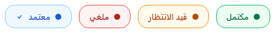
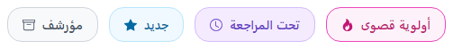
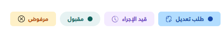
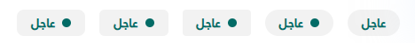
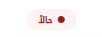

import Tabs from '@theme/Tabs';
import TabItem from '@theme/TabItem';

<Tabs lazy>
<TabItem value="guide" label="Guide" default>
The `_Badge.cshtml` partial view is a reusable UI component that displays a colored badge with optional text, a status dot, an icon, custom borders, and customizable typography. It supports both **Positional Tuples** and **Anonymous Objects** with property aliases.

## UI Preview

| State | Preview |
| :--- | :--- |
| Badges with Custom Borders |  |
| Badges with Icons |  |
| Standard Collection |  |
| Sizes / Border Radius |  |
| Single Dot Badge |  |

---

## Location
`Views/Shared/UI/_Badge.cshtml`

---

## Model Binding Options

`_Badge.cshtml` accepts an `object` model and can be invoked either with **Positional Tuples** or an **Anonymous Object / Dictionary**.

### 1. Positional Tuples (Pattern Matching)

Tuples provide a concise and readable syntax without needing verbose property names:

| Tuple Signature | Parameters & Defaults | Description |
| :--- | :--- | :--- |
| `(string, string, string)` | `(Color, BgColor, Content)`<br/>• `Dot = true`<br/>• `Radius = 4`<br/>• `BorderColor = BgColor` | Minimal badge with default dot and radius. |
| `(string, string, string, string)` | `(Color, BgColor, Content, BorderColor)`<br/>• `Dot = true`<br/>• `Radius = 4` | Badge with a custom border color. |
| `(string, string, string, bool)` | `(Color, BgColor, Content, Dot)`<br/>• `Radius = 4`<br/>• `BorderColor = BgColor` | Badge with custom dot visibility. |
| `(string, string, string, bool, int)` | `(Color, BgColor, Content, Dot, Radius)`<br/>• `BorderColor = BgColor` | Badge with custom dot and border radius. |
| `(string, string, string, bool, int, string)` | `(Color, BgColor, Content, Dot, Radius, BorderColor)` | Full tuple specifying all positional options. |

> **NOTE:** When passing a tuple, the model cannot be null; passing `null` will throw an `ArgumentException`.

---

### 2. Anonymous Object Properties

When using an anonymous object, you can pass named properties. Convenient aliases are supported for common property names:

| Property | Supported Aliases | Type | Required | Default Value | Description |
| :--- | :--- | :--- | :--- | :--- | :--- |
| `label` | `content`, `text` | `string` | **Yes** | `""` | The text content displayed inside the badge. |
| `labelColor` | `color` | `string` | **Yes** | `""` | The text/foreground color (e.g. `"#027A48"`, `"red"`). The status dot also inherits this color. |
| `bgColor` | — | `string` | **Yes** | `""` | The background color of the badge (e.g. `"#ECFDF3"`). |
| `borderColor` | `border` | `string` | No | `BgColor` | Custom border color. If omitted or empty, falls back to `bgColor` (seamless border). |
| `dot` | — | `bool` | No | `true` | If `true`, a circular dot is prepended before the text. Accepts `bool` or string (`"true"` / `"false"`). |
| `radius` | — | `int` | No | `4` | Controls container border-radius. Maps to Bootstrap's `rounded-*` class (`rounded-0` to `rounded-5`). |
| `icon` | — | `string` | No | `null` | Raw HTML string for an icon appended after the text (SVG, `<i>`, ``). |
| `style` | — | `object` | No | `null` | Typography overrides object (see below). |

#### `style` Object Properties
Use this parameter to override default typography:

| Property | Type | Required | Default Value | Description |
| :--- | :--- | :--- | :--- | :--- |
| `fs` | `string` | No | `"14px"` | Specifies `font-size`. E.g., `"14px"`, `"12px"`, `"0.85rem"`. |
| `fw` | `string` | No | `null` (Inherit) | Specifies `font-weight`. E.g., `"600"`, `"bold"`, `"500"`. |

---

## Usage Examples

### 1. Using Tuples

#### Minimal Tuple (3 items)
```csharp
@await Html.PartialAsync("UI/_Badge", ("#027A48", "#ECFDF3", "مكتمل"))
```

#### Tuple with Custom Border (4 items)
```csharp
@await Html.PartialAsync("UI/_Badge", ("#027A48", "#ECFDF3", "مكتمل", "#12B76A"))
```

#### Full Tuple (6 items)
```csharp
@await Html.PartialAsync("UI/_Badge", ("#B42318", "#FEF3F2", "ملغي", true, 4, "#F04438"))
```

---

### 2. Using Anonymous Objects

#### Basic Usage (with property aliases)
Default styling with a dot indicator and standard 14px font:
```csharp
@await Html.PartialAsync("UI/_Badge", new {
    color = "#027A48",
    bgColor = "#ECFDF3",
    text = "مكتمل"
})
```

#### Badge with Custom Border
```csharp
@await Html.PartialAsync("UI/_Badge", new {
    labelColor = "#B54708",
    bgColor = "#FFFAEB",
    borderColor = "#F79009",
    label = "قيد الانتظار"
})
```

#### Badge with an Icon and Custom Typography (`style`)
Using an SVG icon, custom font size, weight, and custom border color:
```csharp
@await Html.PartialAsync("UI/_Badge", new {
    labelColor = "#175CD3",
    bgColor = "#EFF8FF",
    borderColor = "#84CAFF",
    label = "معتمد",
    dot = true,
    radius = 4,
    style = new { fs = "14px", fw = "600" },
    icon = @"<svg xmlns='http://www.w3.org/2000/svg' width='14' height='14' fill='currentColor' viewBox='0 0 16 16'><path d='M10.97 4.97a.75.75 0 0 1 1.07 1.05l-3.99 4.99a.75.75 0 0 1-1.08.02L4.324 8.384a.75.75 0 1 1 1.06-1.06l2.094 2.093 3.473-4.425z'/></svg>"
})
```

#### Badge with a Bootstrap Icon
```csharp
@await Html.PartialAsync("UI/_Badge", new {
    labelColor = "#6941C6",
    bgColor = "#F4EBFF",
    borderColor = "#D6BBFB",
    label = "قيد الإجراء",
    dot = false,
    radius = 2,
    icon = @"<i class='bi bi-clock-history' style='font-size:13px;'></i>"
})
```

</TabItem>


<TabItem value="_Badge.cshtml" label="_Badge.cshtml">

```cshtml
@using Microsoft.AspNetCore.Routing
@model object
@{
string Color = "";
string BgColor = "";
string Content = "";
bool Dot = true;
int Radius = 4;
string? BorderColor = null;
string? Icon = null;
string? Fs = null;
string? Fw = null;

switch (Model)
{
case (string c, string b, string t, bool d, int r, string border):
Color = c; BgColor = b; Content = t; Dot = d; Radius = r; BorderColor = border;
break;
case (string c, string b, string t, bool d, int r):
Color = c; BgColor = b; Content = t; Dot = d; Radius = r;
break;
case (string c, string b, string t, bool d):
Color = c; BgColor = b; Content = t; Dot = d; Radius = 4;
break;
case (string c, string b, string t, string border):
Color = c; BgColor = b; Content = t; Dot = true; Radius = 4; BorderColor = border;
break;
case (string c, string b, string t):
Color = c; BgColor = b; Content = t; Dot = true; Radius = 4;
break;
case null:
throw new ArgumentException("Model cannot be null for _Badge");
default:
var props = new RouteValueDictionary(Model);

if (props.TryGetValue("labelColor", out var lcProp) || props.TryGetValue("color", out lcProp))
Color = lcProp?.ToString() ?? "";
if (props.TryGetValue("bgColor", out var bgProp))
BgColor = bgProp?.ToString() ?? "";
if (props.TryGetValue("borderColor", out var bcProp) || props.TryGetValue("border", out bcProp))
BorderColor = bcProp?.ToString();
if (props.TryGetValue("label", out var lProp) || props.TryGetValue("content", out lProp) || props.TryGetValue("text",
out lProp))
Content = lProp?.ToString() ?? "";
if (props.TryGetValue("dot", out var dProp) && dProp != null)
{
if (dProp is bool b) Dot = b;
else if (bool.TryParse(dProp.ToString(), out bool dVal)) Dot = dVal;
}
if (props.TryGetValue("radius", out var rProp) && rProp != null)
{
if (rProp is int r) Radius = r;
else if (int.TryParse(rProp.ToString(), out int rVal)) Radius = rVal;
}
if (props.TryGetValue("icon", out var icProp))
Icon = icProp?.ToString();
if (props.TryGetValue("style", out var styleProp) && styleProp != null)
{
var styleDict = new RouteValueDictionary(styleProp);
if (styleDict.TryGetValue("fs", out var fsProp) && fsProp != null)
Fs = fsProp.ToString();
if (styleDict.TryGetValue("fw", out var fwProp) && fwProp != null)
Fw = fwProp.ToString();
}
break;
}

var finalBorderColor = !string.IsNullOrWhiteSpace(BorderColor) ? BorderColor : BgColor;
var fontSize = !string.IsNullOrEmpty(Fs) ? $"font-size: {Fs};" : "font-size: 14px;";
var fontWeight = !string.IsNullOrEmpty(Fw) ? $"font-weight: {Fw};" : "";
}

<span class="badge d-flex align-items-center gap-2 px-3 py-2 rounded-@Radius"
    style="background-color: @BgColor; color: @Color; border: 1px solid @finalBorderColor; @fontSize @fontWeight width: fit-content;">
    @if (Dot)
    {
    <span style="width: 10px; height: 10px; background-color: @Color; border-radius: 50%;"></span>
    }
    @Content
    @if (!string.IsNullOrEmpty(Icon))
    {
    @Html.Raw(Icon)
    }
</span>
```

</TabItem>
</Tabs>
