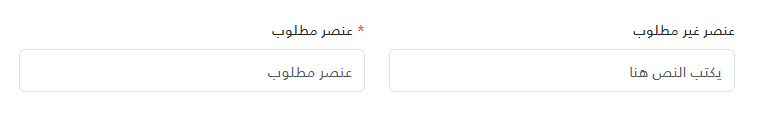
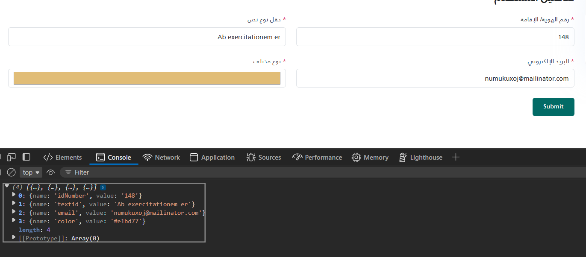

import Tabs from '@theme/Tabs';
import TabItem from '@theme/TabItem';

<Tabs lazy>
<TabItem value="guide" label="Guide" default>
A labelled single-line `<input>` with an optional type and required marker. The input's `name` is the same as its `Id`.

## UI Preview

| State        | Preview                           |
| ------------ | --------------------------------- |
| Single Input |    |
| Group Inputs |   |

---

## How to use

```cshtml
<partial name="UI/_InputField" model='("اسم الحقل الاختياري", false, "field-id", "")' />
<partial name="UI/_InputField" model='("رقم الهوية/ الإقامة", true, "idNumber", " رقم الهوية/ الإقامة", "number")' />
<partial name="UI/_InputField" model='("البريد الإلكتروني", true, "email", " البريد الإلكتروني", "email")' />

@* With an initial value *@
<partial name="UI/_InputField" model='("حقل نوع نص", true, "textid", " نص تجريبي")'
	view-data='new ViewDataDictionary(ViewData) { { "Value", "القيمة الافتراضية" } }' />

@* With type + value *@
<partial name="UI/_InputField" model='("حقل نوع ايميل", true, "emailid", " email address", "email")'
	view-data='new ViewDataDictionary(ViewData) { { "Value", "mail@domain.com" } }' />
```

## Parameters

The model is a tuple, in this order:

| Parameter | Type | Description |
| --- | --- | --- |
| Label | string | The label shown above the input |
| Required | bool | Adds the red asterisk and the `required` attribute |
| Id | string | Used as both `id` and `name`. Must be unique on the page |
| Placeholder | string | Placeholder text. When empty, `يكتب النص هنا` is used |
| Type | string | Optional fifth value: the input `type`. Defaults to `text` |

The initial value is passed separately through `ViewData["Value"]` (see the examples). It defaults to empty.

</TabItem>


<TabItem value="_InputField.cshtml" label="_InputField.cshtml">

```cshtml
@using System.Runtime.CompilerServices
@model ITuple
@{
var label = (string)Model[0];
var required = (bool)Model[1];
var id = (string)Model[2];
var rawPlaceholder = (string)Model[3];
var placeholder = string.IsNullOrEmpty(rawPlaceholder) ? "يكتب النص هنا" : rawPlaceholder;
// Safely handle optional 5th parameter for Type
var type = (Model.Length > 4 && Model[4] != null) ? (string)Model[4] : "text";
if (string.IsNullOrEmpty(type))
{
type = "text";
}
// Optional value passed via view-data: new ViewDataDictionary(ViewData) { { "Value", "..." } }
var value = ViewData["Value"] as string ?? "";
}
@if (!Context.Items.ContainsKey("InputField_Styles_Rendered"))
{
Context.Items["InputField_Styles_Rendered"] = true;
<style>
	input[type=number]::-webkit-outer-spin-button,
	input[type=number]::-webkit-inner-spin-button {
		-webkit-appearance: none;
		margin: 0;
	}

	input {
		-moz-appearance: textfield;
		appearance: textfield;
		direction: rtl;
		text-align: right;
	}
</style>
}
<div class="mb-4">
	<label class="form-label text-gray-700" for="@id">
		@if (required)
		{
		<span class="text-danger">*</span>
		}
		@label
	</label>
	<input type="@type" id="@id" name="@id" class="form-control" placeholder="@placeholder" value="@value" @(required ? "required" : ""
		) />
</div>

```

</TabItem>
</Tabs>
