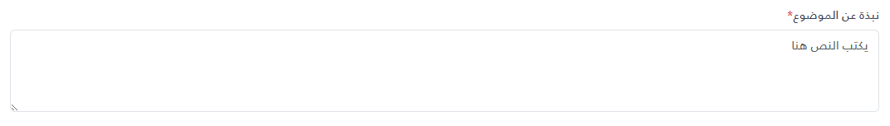

import Tabs from '@theme/Tabs';
import TabItem from '@theme/TabItem';

<Tabs lazy>
<TabItem value="guide" label="Guide" default>
A labelled multi-line text input (`<textarea>`) with an optional required marker.

## UI Preview

| State   | Preview                 |
| ------- | ----------------------- |
| Default |  |

---

## How to use

```cshtml
<partial name="UI/_TextArea" model='("عنصر مطلوب بقيمة توضيحيه", true, "my-custom-id-1", "عنصر مطلوب بقيمة توضيحيه")' />

@* With an initial value *@
<partial name="UI/_TextArea" model='("عنصر غير مطلوب", false, "my-custom-id-2", "")'
	view-data='new ViewDataDictionary(ViewData) { { "Value", "القيمة الافتراضية" } }' />

@await Html.PartialAsync("UI/_TextArea",
		(Label: "Notes", Required: false, Id: "notes", Placeholder: ""),
		new ViewDataDictionary(ViewData) { { "Value", "this is test text" } })
```

## Parameters

The model is a tuple, in this order:

| Parameter | Type | Description |
| --- | --- | --- |
| Label | string | The label shown above the textarea |
| Required | bool | Adds the red asterisk and the `required` attribute |
| Id | string | The `id` of the textarea. Must be unique on the page |
| Placeholder | string | Placeholder text. When empty, `يكتب النص هنا` is used |

The initial value is passed separately through `ViewData["Value"]` (see the examples). It defaults to empty.

## Known limitations

- The textarea has an `id` but no `name` attribute, so its value is **not** posted with a normal form submit. Read it by id in JavaScript, or add the value to your request yourself.

</TabItem>


<TabItem value="_TextArea.cshtml" label="_TextArea.cshtml">

```cshtml
@model (string Label, bool Required, string Id, string Placeholder)
@{
    var placeholder = string.IsNullOrEmpty(Model.Placeholder) ? "يكتب النص هنا" : Model.Placeholder;
    var value = ViewData["Value"] as string ?? "";
}
<div class="mb-4">
	<label class="form-label text-gray-700" for="@Model.Id">
		@if (Model.Required)
		{
		<span class="text-danger">*</span>
		}
		@Model.Label
	</label>
	<textarea id="@Model.Id" class="form-control" style="height: 100px;" rows="3" placeholder="@placeholder"
		@(Model.Required ? "required" : "" )>@value</textarea>
</div>

```

</TabItem>
</Tabs>
