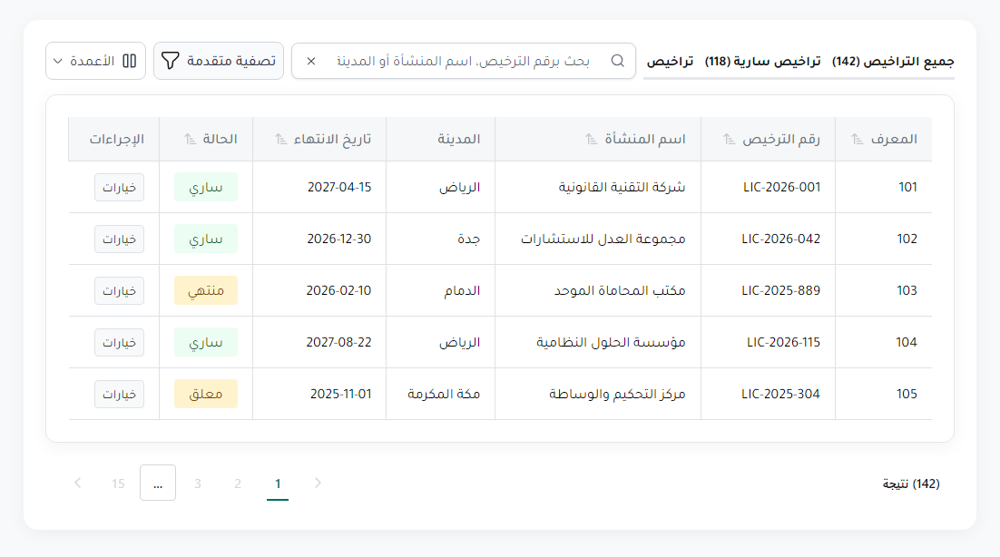
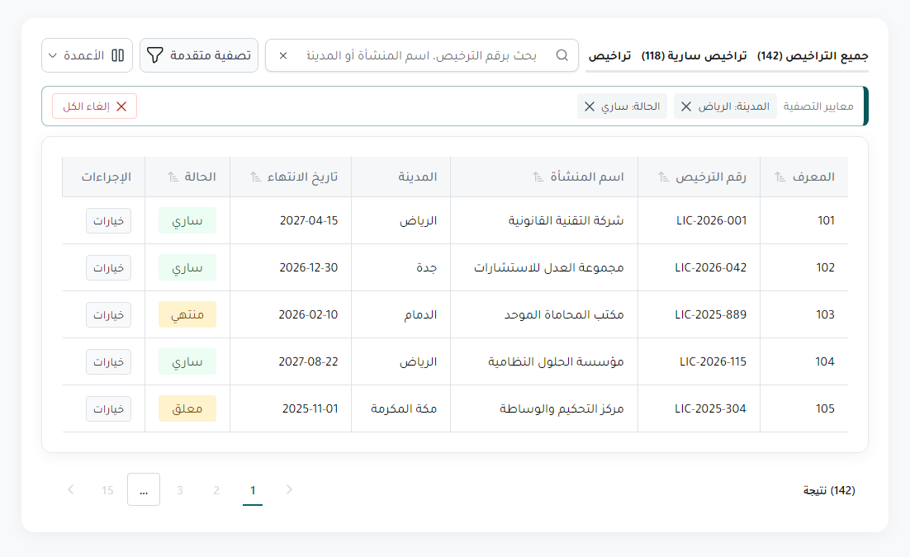
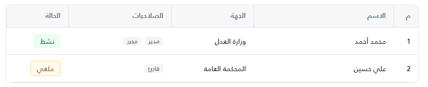
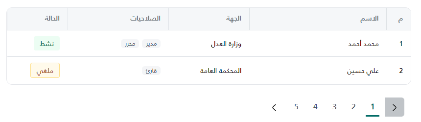

import Tabs from '@theme/Tabs';
import TabItem from '@theme/TabItem';

<Tabs lazy>
<TabItem value="guide" label="Guide" default>
A lightweight, dependency-free plain-JavaScript component (no jQuery) for rendering dynamic, accessible HTML tables in RTL and LTR applications. It supports client-side column sorting with Arabic collation, customizable pagination with page-size selection, an active filter chips bar, horizontal navigation tabs, a searchable column picker, an export menu, search debouncing, and vertical column borders. Styled with Bootstrap 5 and customized for Momah design system.

## UI Preview

| State | Preview |
| :--- | :--- |
| Complete Table View |  |
| Active Filters Chips Bar |  |
| Standard Table Layout |  |
| Classic Pagination |  |

---

## Quick Start (3 Steps)

### 1. Include Files

```html
<!-- Table styling and dropdowns -->
<link rel="stylesheet" href="/assets/css/momah-table.css" />

<!-- Accessible pagination and table footer -->
<link rel="stylesheet" href="/assets/css/pagination.css" />

<!-- MomahTable core script -->
<script src="/assets/js/momahTable.js"></script>
```

### 2. Create HTML Containers

```html
<!-- Optional host for Tabs, Search, Filter, Column Picker, and Export -->
<div id="tableActions"></div>

<!-- Required container for the dynamic table -->
<div id="tableContainer"></div>

<!-- Optional external pager host (if omitted, footer is rendered within table wrapper) -->
<div id="pagination"></div>
```

### 3. Render the Table

```javascript
const data = [
    { id: 101, name: 'أحمد محمود', role: 'محامي مرخص', status: 'نشط' },
    { id: 102, name: 'سارة خالد', role: 'مستشار قانوني', status: 'معلق' }
];

const columns = [
    { header: 'المعرف', field: 'id', width: '80px', sortable: true },
    { header: 'الاسم', field: 'name', sortable: true },
    { header: 'الدور الوظيفي', field: 'role' },
    { 
        header: 'الحالة', 
        render: (record) => `<span class="status-pill status-${record.status === 'نشط' ? 'published' : 'unpublished'}">${record.status}</span>` 
    }
];

MomahTable.render('#tableContainer', columns, data);
```

---

## Table Options API

`MomahTable.render(containerSelector, columns, records, options)` accepts the following options:

| Property | Type | Default | Description |
| :--- | :--- | :--- | :--- |
| `showBorders` | Boolean | `false` | When `true`, adds vertical borders between body columns matching the header (`.momah-table-bordered`). |
| `tabs` | Array | `undefined` | Array of tab objects (`{ label, url, active, onClick }`) rendered before search or in a dedicated row above the table. |
| `search` | Object | `undefined` | Configuration for search input (ID, placeholder, events). |
| `filter` | Object | `undefined` | Configuration for filter button, modal triggers, and active filter chips bar. |
| `filter.filterChips` | Boolean | `false` | Enables the active filter chips bar (`.momah-active-filters`) when `filter.active` is populated. |
| `filter.active` | Array | `[]` | List of active filter chip objects (`{ text, onRemove }`). |
| `filter.onClearAll` | Function | `undefined` | Callback invoked when user clicks "Clear All" (`إلغاء الكل`). |
| `columnPicker` | Object \| Boolean | `undefined` | Enables column visibility dropdown with live search. |
| `export` | Array | `undefined` | Array of export action definitions (`label`, `onClick`). |
| `exportRecords` | Array | `undefined` | Full records dataset to pass to export handlers when `records` is paginated. |
| `pagination` | Object | `undefined` | Comprehensive footer configuration (current page, total pages, total count, page size selector). |
| `skipActions` | Boolean | `false` | Internal flag used on column toggle or sort to preserve toolbar state. |

---

## Column Configuration

Each object in the `columns` array can define:

| Property | Type | Default | Description |
| :--- | :--- | :--- | :--- |
| `header` | String | `""` | Column header title (HTML string or text). |
| `field` | String | `undefined` | Property name on the record object to display. |
| `render` | Function | `undefined` | Custom cell renderer: `(record, index) => string`. Can return HTML. |
| `sortable` | Boolean | `false` | When `true`, enables client-side sorting with Arabic collation (`Intl.Collator`) and ARIA sort attributes. |
| `width` | String | `undefined` | Explicit CSS width (e.g. `'100px'`, `'20%'`). |
| `className` | String | `undefined` | CSS class for header cell (`<th>`). |
| `tdClassName` | String | `undefined` | CSS class for data cells (`<td>`). |
| `hide` | Boolean | `false` | Set `true` to hide column initially. It remains toggleable in the column picker unless permanently excluded. |
| `show` | Boolean | `true` | Set `false` to hide column initially. |

> **NOTE:** Headers that contain interactive elements (buttons, links, inputs) cannot be sortable and will render as standard non-sortable headers even if `sortable: true` is specified.

---

## Key Features & Examples

### 1. Client-Side Column Sorting (`sortable: true`)

Columns with `sortable: true` render interactive header buttons with arrow icons and proper `aria-sort` attributes (`none`, `ascending`, `descending`). Sorting handles Arabic characters, numbers, and dates chronologically.

```javascript
const columns = [
    { header: 'رقم القضية', field: 'caseNumber', width: '120px', sortable: true },
    { header: 'تاريخ الجلسة', field: 'sessionDate', width: '150px', sortable: true },
    { header: 'المحكمة', field: 'courtName', sortable: true },
    { 
        header: 'حالة القضية', 
        render: (rec) => `<span class="status-pill status-published">${rec.status}</span>`,
        sortable: true // Extracts text content from rendered HTML for sorting
    }
];

MomahTable.render('#tableContainer', columns, casesData);
```

### 2. Active Filters Bar (`filter.active` & `filter.filterChips: true`)

When filters are applied, pass `filterChips: true` and `filter.active` to display a filter chip bar above the table. Users can remove individual chips or click "Clear All" (`إلغاء الكل`).

```javascript
MomahTable.render('#tableContainer', columns, data, {
    filter: {
        containerSelector: '#tableActions',
        label: 'تصفية متقدمة',
        targetModalId: 'advancedFilterModal',
        filterChips: true,
        active: [
            { key: 'status', text: 'الحالة: نشط', onRemove: () => removeFilter('status') },
            { key: 'court', text: 'المحكمة: الرياض العامة', onRemove: () => removeFilter('court') }
        ],
        onClearAll: () => resetAllFilters()
    }
});
```

### 3. Navigation Tabs (`tabs`)

Tabs sit at the start of the toolbar row (or standalone above the table). Long tab lists support touch and trackpad horizontal scrolling.

```javascript
MomahTable.render('#tableContainer', columns, data, {
    tabs: [
        { label: 'جميع القضايا (142)', url: '/cases/all', active: true },
        { label: 'قضايا جارية (118)', url: '/cases/active' },
        { label: 'قضايا منتهية (24)', url: '/cases/closed' },
        { label: 'المسودات', onClick: () => filterDrafts(), active: false }
    ],
    search: {
        containerSelector: '#tableActions',
        placeholder: 'بحث في القضايا...'
    }
});
```

### 4. Searchable Column Picker (`columnPicker`)

The column picker includes a sticky live search input to quickly find columns in tables with dozens of fields.

```javascript
MomahTable.render('#tableContainer', columns, data, {
    columnPicker: {
        containerSelector: '#tableActions' // or omitted to place on a standalone row
    }
});
```

### 5. Configurable Data Export (`export`)

The export dropdown renders a primary green button (`تصدير`) that opens available export targets. Each item handler receives a complete context object containing the current table state:

```javascript
MomahTable.render('#tableContainer', columns, currentPageRecords, {
    export: [
        {
            label: 'تصدير كـ Excel (XLSX)',
            onClick: (context) => {
                console.log('Columns to export:', context.selectedColumns);
                console.log('Records to export:', context.records);
                console.log('Search query applied:', context.searchValue);
                console.log('Active filters:', context.filters);
                exportToExcel(context.records, context.selectedColumns);
            }
        },
        {
            label: 'تصدير كـ PDF',
            onClick: (context) => exportToPdf(context.records)
        }
    ],
    // Pass entire dataset if currentPageRecords is only 1 page of 10
    exportRecords: allSystemRecords
});
```

### 6. Full Pagination Footer & Page Size Selector (`pagination`)

The responsive footer incorporates page navigation, page size selection, and total records count in a single accessible row.

```javascript
MomahTable.render('#tableContainer', columns, data, {
    pagination: {
        containerSelector: '#pagination', // Optional; if omitted, rendered under the table
        currentPage: 1,
        totalPages: 25,
        totalCount: 250, // Displays "عرض 1 إلى 10 من أصل 250 سجل"
        pageSize: {
            value: 10,
            options: [10, 25, 50, 100],
            onChange: (newSize) => {
                pageSize = newSize;
                loadPage(1);
            }
        },
        onPageChange: (page) => {
            loadPage(page);
        }
    }
});
```

### 7. Vertical Column Borders (`showBorders`)

To display vertical grid lines on body cells matching the header cells:

```javascript
MomahTable.render('#tableContainer', columns, data, {
    showBorders: true
});
```

---

## Complete Example with All Features

```javascript
const columns = [
    { header: 'المعرف', field: 'id', width: '90px', sortable: true },
    { header: 'رقم الترخيص', field: 'licenseNumber', sortable: true },
    { header: 'اسم المنشأة', field: 'facilityName', sortable: true },
    { header: 'المدينة', field: 'city' },
    { header: 'تاريخ الانتهاء', field: 'expiryDate', sortable: true },
    { 
        header: 'حالة الترخيص', 
        render: (rec) => `<span class="status-pill status-${rec.statusClass}">${rec.statusText}</span>`,
        sortable: true
    },
    {
        header: 'إجراءات',
        render: (rec) => `
            <div class="dropdown">
                <button class="btn btn-sm btn-light" data-bs-toggle="dropdown">•••</button>
                <ul class="dropdown-menu">
                    <li><a class="dropdown-item" href="/licenses/edit/${rec.id}">تعديل</a></li>
                    <li><a class="dropdown-item ${rec.canRenew ? '' : 'momah-disabled-link'}" href="/licenses/renew/${rec.id}">تجديد</a></li>
                </ul>
            </div>
        `
    }
];

MomahTable.render('#tableContainer', columns, records, {
    showBorders: true,
    tabs: [
        { label: 'الكل', url: '/licenses', active: true },
        { label: 'سارية', url: '/licenses?status=active' },
        { label: 'منتهية', url: '/licenses?status=expired' }
    ],
    search: {
        containerSelector: '#tableActions',
        inputId: 'txtSearchLicense',
        placeholder: 'بحث برقم الترخيص أو اسم المنشأة...'
    },
    filter: {
        containerSelector: '#tableActions',
        label: 'تصفية',
        targetModalId: 'modalFilterLicenses',
        filterChips: true,
        active: [
            { key: 'city', text: 'المدينة: الرياض', onRemove: () => removeFilter('city') }
        ],
        onClearAll: () => resetFilters()
    },
    columnPicker: {
        containerSelector: '#tableActions'
    },
    export: [
        {
            label: 'تصدير إلى ملف Excel',
            onClick: (ctx) => downloadExcel(ctx.records, ctx.selectedColumns)
        }
    ],
    exportRecords: allLicensesList,
    pagination: {
        containerSelector: '#pagination',
        currentPage: 1,
        totalPages: 10,
        totalCount: 100,
        pageSize: {
            value: 10,
            options: [10, 20, 50],
            onChange: (size) => onPageSizeChange(size)
        },
        onPageChange: (page) => onPageChange(page)
    }
});
```

---

## Event Handling Lifecycle

When search inputs are rendered, `MomahTable` hooks `Enter` key presses, search glass clicks, and clear button clicks (`X`). It automatically triggers the first defined handler:

1. `window.performSearch()`
2. `window.LoadData()`
3. `options.filter.onFilter`

If a global function `window.initializeSearchInput()` exists on the page, it is also executed whenever the search bar is rendered.

```javascript
function performSearch() {
    const term = document.getElementById('txtSearchLicense').value;
    fetchData({ search: term, page: 1 });
}
```

---

## Accessibility & Keyboard Navigation

- **Sortable Headers:** Use native button controls (`.momah-sort-btn`) with `aria-sort="none|ascending|descending"`. Focus is maintained on the active sort column across re-renders.
- **Pagination Controls:** Buttons announce active status with `aria-current="page"` and preserve focus via internal `data-focus-key` mapping when navigating between pages.
- **RTL Alignment:** Full native right-to-left layout alignment with CSS logical properties (`margin-inline-start`, `inset-inline-start`, `border-inline-start`).

</TabItem>


<TabItem value="momah-table.css" label="momah-table.css">

```css
/* this file contains data table styles and action button with dropdown */

/* Table look */
.momah-table-host .table-wrapper,
.momah-table-host .jtable-main-container {
	border: 1px solid #e5e7eb;
	border-radius: 12px;
	overflow: hidden;
	background: #fff;
}

table thead th {
	border-left: var(--bs-border-width) var(--bs-border-style) var(--bs-border-color) !important;
}

/* Header background */
.momah-table-host .table thead,
.momah-table-host .table thead tr,
.momah-table-host .table thead th,
.momah-table-host .jtable thead,
.momah-table-host .jtable thead tr,
.momah-table-host .jtable thead th {
	background-color: #f5f7f9 !important;
}

/* Bootstrap table var */
.momah-table-host .table thead {
	--bs-table-bg: #f5f7f9 !important;
}

/* Header cells */
.momah-table-host .table thead th,
.momah-table-host .jtable thead th {
	color: #6c757d !important;
	font-weight: 500;
	padding: 12px 16px !important;
}

/* options.showBorders: body column borders matching the header's; the last cell skips it to avoid doubling the wrapper border */
.momah-table-host .momah-table-bordered tbody td:not(:last-child) {
	border-left: var(--bs-border-width) var(--bs-border-style) var(--bs-border-color);
}

/* Body cells */
.momah-table-host .table tbody td,
.momah-table-host .jtable tbody td {
	vertical-align: middle;
	padding: 12px 16px !important;
}

.momah-table-host .wrappingText {
	white-space: nowrap;
	overflow: hidden;
	text-overflow: ellipsis;
	max-width: 520px;
}

/* Status pill styles */
.status-pill {
	display: flex;
	justify-content: center;
	align-items: center;
	padding: 4px 12px;
	border-radius: 4px;
	font-weight: 400;
}

.status-published {
	background: var(--Tag-tag-background-success-light, rgba(236, 253, 243, 1));
	color: var(--Tag-tag-text-success, rgba(8, 93, 58, 1));
}

.status-draft {
	background: #f8f9fa;
	color: #212529;
}

.status-unpublished {
	background: #fff3cd;
	color: #7a4b00;
}

.status-inprogress,
.status-completed {
	background: var(--Tag-tag-background-neutral-light, rgba(249, 250, 251, 1));
	color: var(--Tag-tag-text-neutral, rgba(31, 42, 55, 1));
}

.status-rejected {
	background: var(--Tag-tag-background-warning-light, rgba(255, 250, 235, 1));
	border: 1px solid var(--Tag-tag-border-warning-light, rgba(254, 223, 137, 1));
	color: var(--Tag-tag-text-warning, rgba(147, 55, 13, 1));
}

.duration-pill {
	display: inline-flex;
	align-items: center;
	justify-content: center;
	padding: 2px 10px;
	border-radius: 4px;
	background: #e8f7f7;
	color: #016b68;
	font-weight: 500;
	/* Short values keep the old 91px pill; longer ones grow on one line instead of wrapping inside it */
	min-width: 91px;
	white-space: nowrap;
	border: 1px solid rgba(179, 233, 233, 1);
	unicode-bidi: plaintext;
}

/*Table action button and dropdown */
.action-btn {
	width: 24px;
	height: 24px;
	border-radius: 50%;
	border: none;
	background: #fff;
	color: #6c757d;
	display: inline-flex;
	align-items: center;
	justify-content: center;
}

.dropdown-menu {
	min-width: 180px;
	position: absolute;
}

/* Role chips inside roles column */
.momah-table-host .roles-cell {
	display: flex;
	flex-wrap: wrap;
	gap: 6px;
}

.momah-table-host .role-chip {
	display: inline-flex;
	align-items: center;
	padding: 2px 8px;
	border-radius: 6px;
	background: #f3f4f6e4;
	color: #374151;
	font-size: 12px;
	line-height: 1.2;
}

/* MomahTable Active Filters Bar */
.momah-active-filters {
	display: flex;
	align-items: center;
	flex-wrap: wrap;
	gap: 8px;
	margin-bottom: 12px;
	padding: 8px 12px;
	background: #ffffff;
	border: 1px solid #97BABA;
	border-inline-start: 6px solid #045859;
	border-radius: 8px;
}

.momah-active-filters-title {
	color: #6B7280;
	font-size: 14px;
}

.momah-filter-chip {
	display: inline-flex;
	align-items: center;
	gap: 8px;
	padding: 4px 8px;
	background: #F3F6F6;
	border: 1px solid #F3F6F6;
	border-radius: 4px;
	color: #161616;
	font-size: 14px;
}

.momah-filter-chip-remove {
	display: inline-flex;
	padding: 0;
	background: none;
	border: none;
	color: #384250;
}

.momah-filters-clear-all {
	display: inline-flex;
	align-items: center;
	gap: 8px;
	margin-inline-start: auto;
	padding: 4px 12px;
	background: #fff;
	border: 1px solid #FECDCA;
	border-radius: 4px;
	color: #B42318;
	font-size: 14px;
}

.momah-filters-clear-all:hover {
	background: #fef3f2;
}

/* MomahTable Host Containers */
.momah-actions-host {
	margin-bottom: 1rem;
}

/* MomahTable Search Bar */
.momah-search-input {
	border: 1px solid #d1d5db;
	border-radius: 8px;
	padding: 12px 50px;
	background: #ffffff;
	height: 40px;
	box-shadow: 0 1px 3px rgba(0, 0, 0, 0.1);
}

.momah-btn-clear {
	left: 12px;
	top: 50%;
	transform: translateY(-50%);
	background: none;
	border: none;
	color: #6b7280;
	font-size: 16px;
	display: none;
	width: 20px;
	height: 20px;
}

.momah-search-icon {
	right: 12px;
	top: 50%;
	transform: translateY(-50%);
	color: #6b7280;
	cursor: pointer;
	/* A <button>: drop the browser's button box so it stays a bare 16px icon */
	padding: 0;
	border: 0;
	background: none;
}

/* MomahTable Filter Button */
.momah-filter-btn {
	background-color: #f9fafb;
	color: #374151;
	border: 1px solid #d1d5db;
	border-radius: 8px;
	padding: 8px;
	font-weight: 500;
	min-width: 140px;
}

.momah-filter-btn-icon {
	font-size: 12px;
	color: #6b7280;
	margin-left: 4px;
}

.search-container {
	position: relative;
}

/* options.tabs: page links at the start of the search row. Long lists scroll sideways. */
.momah-tabs {
	display: flex;
	align-self: stretch;
	gap: 12px;
	flex: 1 1 0;
	min-width: 0;
	overflow-x: auto;
	scrollbar-width: none;
	box-shadow: inset 0 -3px 0 #e5e7eb;
}

.momah-tab {
	position: relative;
	display: flex;
	align-items: center;
	color: #161616;
	font-size: 15px;
	font-weight: 600;
	white-space: nowrap;
	text-decoration: none;
}

.momah-tab:hover {
	color: #026b66;
}

.momah-tab[aria-current="page"] {
	color: #026b66;
	font-weight: 700;
}

.momah-tab[aria-current="page"]::after {
	content: "";
	position: absolute;
	inset-inline: 0;
	bottom: 0;
	height: 3px;
	background: #026b66;
	border-radius: 2px;
}

.momah-tab:focus-visible {
	outline: 2px solid #026b66;
	outline-offset: 1px;
}

/* No toolbar: same height and gap as the toolbar row */
.momah-tabs-standalone {
	min-height: 40px;
	margin-bottom: 1rem;
}

/* Column picker / export without a toolbar host: their own row, controls on the right in LTR and RTL */
.momah-cols-standalone > .d-flex {
	display: flex;
	align-items: center;
	min-height: 40px;
}

/* LTR: the first control takes the free space. RTL rows already start on the right. */
.momah-cols-standalone > .d-flex > div:first-of-type {
	margin-left: auto !important;
}

[dir="rtl"] .momah-cols-standalone > .d-flex > div:first-of-type {
	margin-left: 0 !important;
}

/* With tabs the search keeps a fixed width instead of filling the row */
.momah-tabs + .search-container {
	flex: 0 1 380px !important;
}

/* Small screens: the tabs take their own line above the search */
@media (max-width: 767.98px) {
	.momah-actions-host > .d-flex:has(> .momah-tabs) {
		flex-wrap: wrap;
	}

	.momah-tabs {
		flex-basis: 100%;
	}
}

.search-input {
	transition: all 0.2s ease;
}

.search-input:focus {
	border-color: #016b68 !important;
	box-shadow: 0 0 0 0.2rem rgba(1, 107, 104, 0.25) !important;
	outline: none;
}

.btn-clear {
	transition: color 0.2s ease;
	display: flex !important;
	align-items: center !important;
	justify-content: center !important;
}

.btn-clear:hover,
.search-icon-text:hover {
	color: #374151 !important;
}

.filter-btn,
.search-icon-text {
	transition: color 0.2s ease;
}

.filter-btn:hover {
	background-color: #f3f4f6 !important;
	border-color: #9ca3af !important;
}

/* Ensure icons are properly displayed */
.btn-clear i,
.filter-btn i {
	display: inline-block !important;
	font-style: normal !important;
	font-variant: normal !important;
	text-rendering: auto !important;
	line-height: 1 !important;
}

/* Columns and Export Dropdowns */
.momah-cols-dropdown,
.momah-export-dropdown {
	position: relative;
	display: inline-block;
}

.momah-cols-menu,
.momah-export-menu {
	display: none;
	position: absolute;
	left: 0;
	/* Default to left alignment (LTR) - user can override or we can detect RTL */
	top: 100%;
	z-index: 1000;
	min-width: 200px;
	background: #fff;
	border: 1px solid #e5e7eb;
	border-radius: 8px;
	box-shadow: 0 4px 6px -1px rgba(0, 0, 0, 0.1), 0 2px 4px -1px rgba(0, 0, 0, 0.06);
	padding: 8px;
	margin-top: 4px;
	max-height: 300px;
	overflow-y: auto;
}

/* RTL Support for dropdown alignment if needed, usually driven by HTML dir="rtl" */
[dir="rtl"] .momah-cols-menu,
[dir="rtl"] .momah-export-menu {
	left: auto;
	right: 0;
}

.momah-cols-menu.show,
.momah-export-menu.show {
	display: block;
}

/* Column picker search: stays at the top while the list scrolls */
.momah-cols-search {
	position: sticky;
	top: -8px;
	z-index: 1;
	margin: -8px -8px 4px;
	padding: 8px;
	background: #fff;
}

.momah-cols-search-input {
	width: 100%;
	height: 36px;
	padding-block: 0;
	padding-inline: 32px 10px;
	border: 1px solid #d1d5db;
	border-radius: 6px;
	color: #374151;
	font-size: 14px;
}

.momah-cols-search-input:focus {
	outline: none;
	border: none;
}

.momah-cols-search-icon {
	position: absolute;
	inset-inline-start: 18px;
	top: 50%;
	transform: translateY(-50%);
	color: #6b7280;
	pointer-events: none;
}

.momah-cols-empty {
	padding: 8px 12px;
	color: #6b7280;
	font-size: 14px;
	text-align: center;
}

.momah-col-item {
	display: flex;
	align-items: center;
	padding: 8px 12px;
	cursor: pointer;
	border-radius: 6px;
	transition: background-color 0.2s;
	margin-bottom: 2px;
}

.momah-col-item:hover,
.momah-export-item:hover,
.momah-export-item:focus-visible {
	background-color: #f3f4f6;
}

/* Export items: same look as column items, as buttons */
.momah-export-item {
	display: block;
	width: 100%;
	padding: 8px 12px;
	margin-bottom: 2px;
	border: 0;
	border-radius: 6px;
	background: transparent;
	color: #374151;
	font-size: 14px;
	text-align: start;
	cursor: pointer;
}

.momah-export-item:focus-visible {
	outline: 2px solid #026b66;
	outline-offset: -2px;
}

.momah-col-checkbox {
	margin-inline-end: 10px;
	width: 16px;
	height: 16px;
	cursor: pointer;
	accent-color: #016b68;
}

.momah-col-label {
	font-size: 14px;
	color: #374151;
	user-select: none;
	flex-grow: 1;
}

.momah-cols-btn {
	background-color: #fff;
	color: #374151;
	border: 1px solid #d1d5db;
	border-radius: 8px;
	padding:8px;
	display: flex;
	align-items: center;
	justify-content: center;
	transition: all 0.2s;
}

.momah-export-btn {
	background-color: #045859;
	color: #FFFFFF;
	border: 1px solid #045859;
	border-radius: 8px;
	padding:8px;
	display: flex;
	align-items: center;
	justify-content: space-between;
	gap: 8px;
	transition: all 0.2s;
}

.momah-cols-btn:hover {
	background-color: #f9fafb;
	border-color: #9ca3af;
}

/* Rotate arrow when dropdown is open */
.momah-cols-btn[aria-expanded="true"] .momah-arrow-icon,
.momah-export-btn[aria-expanded="true"] .momah-arrow-icon {
	transform: rotate(180deg);
}

.momah-arrow-icon {
	transition: transform 0.3s ease-in-out;
}

/* Sortable header (column sortable: true): the header text is a plain button; the arrow is faint until the column is sorted.
   !important beats main.rtl.css "table button" (padding, and white text at 0.8 opacity on hover/focus). */
.momah-table-host .momah-sort-btn {
	display: inline-flex;
	align-items: center;
	gap: 6px;
	margin: 0 !important;
	padding: 0 !important;
	border: 0;
	background: none !important;
	font: inherit;
	color: inherit !important;
	opacity: 1 !important;
	text-align: inherit;
	cursor: pointer;
}

.momah-table-host .momah-sort-btn:focus-visible {
	outline: 2px solid #026b66;
	outline-offset: 2px;
}

.momah-sort-btn .momah-sort-icon {
	flex-shrink: 0;
	opacity: 0.35;
}

.momah-sortable[aria-sort="ascending"] .momah-sort-icon,
.momah-sortable[aria-sort="descending"] .momah-sort-icon {
	opacity: 1;
}

/* The arrow path has a fixed grey fill; on the export button it follows the white text */
.momah-export-btn .momah-arrow-icon path {
	fill: currentColor;
}

/* A menu item the current user cannot use */
.momah-table-host .momah-disabled-link {
	pointer-events: none;
	opacity: 0.5;
	cursor: not-allowed;
}

```

</TabItem>
<TabItem value="momahTable.js" label="momahTable.js">

```javascript
(function (global) {
  "use strict";

  // Default SVG if none provided
  const defaultIcon = `<svg width="20" height="20" viewBox="0 0 20 20" fill="none" xmlns="http://www.w3.org/2000/svg">
							<path fill-rule="evenodd" clip-rule="evenodd" d="M3.93213 1.58e-06C3.94946 2.35486e-06 3.96686 3.12972e-06 3.98431 3.12972e-06L15.5678 1.58e-06C16.3384 -3.38252e-05 16.9926 -6.38664e-05 17.5087 0.0703036C18.0549 0.144785 18.5773 0.312914 18.9772 0.753097C19.3806 1.19714 19.491 1.73226 19.4994 2.27927C19.5073 2.79013 19.4257 3.42472 19.3305 4.16461L19.3235 4.2185C19.2899 4.48033 19.2393 4.73356 19.134 4.98711C19.0271 5.24453 18.8798 5.46377 18.6964 5.68165C17.7167 6.84554 15.8954 8.9489 13.3314 10.8644C13.29 10.8954 13.2376 10.9688 13.2276 11.079C12.9785 13.8319 12.7594 15.2885 12.6013 16.1323C12.4303 17.0448 11.7343 17.6764 11.1341 18.1112C10.8201 18.3388 10.4867 18.5437 10.1898 18.7244C10.166 18.7389 10.1425 18.7532 10.1193 18.7673C9.84191 18.936 9.6061 19.0794 9.409 19.2187C8.86849 19.6009 8.24491 19.5741 7.76827 19.2964C7.31847 19.0344 7.00196 18.5565 6.93796 18.016C6.7975 16.8296 6.54286 14.5069 6.26176 11.0726C6.25274 10.9624 6.23553 10.9305 6.2341 10.9278C6.23311 10.9259 6.23058 10.9213 6.22219 10.9121C6.2128 10.9017 6.19403 10.8835 6.15835 10.8568C3.59952 8.94368 1.78182 6.844 0.803507 5.68162C0.620802 5.46453 0.46921 5.25051 0.361123 4.99022C0.255311 4.73541 0.210192 4.48089 0.17644 4.21849C0.174121 4.20047 0.171809 4.18251 0.169505 4.1646C0.0742886 3.42472 -0.00737744 2.79013 0.000530313 2.27927C0.00899769 1.73226 0.119419 1.19714 0.522804 0.753097C0.922685 0.312914 1.44502 0.144785 1.9913 0.0703036C2.50741 -6.38664e-05 3.16157 -3.38252e-05 3.93213 1.58e-06ZM2.19394 1.55655C1.80984 1.60892 1.69414 1.69449 1.63307 1.76171C1.57551 1.82507 1.50601 1.93665 1.50035 2.30249C1.49432 2.69212 1.56012 3.21812 1.66418 4.02712C1.693 4.25193 1.71843 4.34754 1.74643 4.41496C1.77215 4.47691 1.81773 4.55722 1.95114 4.71572C2.90942 5.85431 4.63846 7.84756 7.05654 9.65542C7.25081 9.80066 7.42905 9.98047 7.558 10.2226C7.68505 10.4612 7.73704 10.7094 7.75676 10.9502C8.03632 14.3658 8.28914 16.6704 8.42756 17.8396C8.43178 17.8753 8.44476 17.9104 8.46474 17.9411C8.48518 17.9724 8.50789 17.9913 8.52333 18.0003C8.5253 18.0015 8.52703 18.0024 8.52851 18.0031C8.53207 18.0012 8.53688 17.9983 8.54298 17.994C8.78509 17.8228 9.0661 17.652 9.33133 17.4909C9.35774 17.4748 9.38398 17.4589 9.41002 17.443C9.70883 17.2612 9.99461 17.0845 10.254 16.8966C10.8008 16.5003 11.069 16.1651 11.1269 15.8561C11.2734 15.0743 11.4872 13.6681 11.7337 10.9438C11.7789 10.4447 12.024 9.9688 12.4337 9.66271C14.8567 7.85253 16.5892 5.85571 17.5488 4.7157C17.6652 4.57745 17.7169 4.48831 17.7488 4.4116C17.7823 4.33102 17.8104 4.2244 17.8358 4.02712C17.9399 3.21812 18.0057 2.69212 17.9996 2.30249C17.994 1.93665 17.9245 1.82507 17.8669 1.76171C17.8058 1.69449 17.6901 1.60892 17.306 1.55655C16.9034 1.50165 16.3527 1.5 15.5157 1.5H3.98431C3.14726 1.5 2.5966 1.50165 2.19394 1.55655ZM8.52065 18.0066C8.52069 18.0066 8.52118 18.0064 8.52211 18.0062L8.52065 18.0066Z" fill="#161616"/>
					</svg>`;

  const onlyFilterIcon = `<svg width="40" height="40" viewBox="0 0 40 40" fill="none" xmlns="http://www.w3.org/2000/svg">
							<path d="M4 0.5H36C37.933 0.5 39.5 2.067 39.5 4V36C39.5 37.933 37.933 39.5 36 39.5H4C2.067 39.5 0.5 37.933 0.5 36V4C0.500001 2.067 2.067 0.5 4 0.5Z" stroke="#D2D6DB"/>
							<path fill-rule="evenodd" clip-rule="evenodd" d="M25.75 13.2545V11C25.75 10.5858 25.4142 10.25 25 10.25C24.5858 10.25 24.25 10.5858 24.25 11V13.2545C24.1074 13.2575 23.9758 13.2625 23.8546 13.2708C23.5375 13.2924 23.238 13.339 22.9476 13.4593C22.2738 13.7384 21.7384 14.2738 21.4593 14.9476C21.339 15.238 21.2924 15.5375 21.2708 15.8546C21.25 16.1592 21.25 16.5302 21.25 16.9747V17.0253C21.25 17.4697 21.25 17.8408 21.2708 18.1454C21.2924 18.4625 21.339 18.762 21.4593 19.0524C21.7384 19.7262 22.2738 20.2616 22.9476 20.5407C23.238 20.661 23.5375 20.7076 23.8546 20.7292C24.1592 20.75 24.5303 20.75 24.9747 20.75H25.0253C25.4697 20.75 25.8408 20.75 26.1454 20.7292C26.4625 20.7076 26.762 20.661 27.0524 20.5407C27.7262 20.2616 28.2616 19.7262 28.5407 19.0524C28.661 18.762 28.7076 18.4625 28.7292 18.1454C28.75 17.8408 28.75 17.4698 28.75 17.0253V16.9747C28.75 16.5303 28.75 16.1592 28.7292 15.8546C28.7076 15.5375 28.661 15.238 28.5407 14.9476C28.2616 14.2738 27.7262 13.7384 27.0524 13.4593C26.762 13.339 26.4625 13.2924 26.1454 13.2708C26.0242 13.2625 25.8926 13.2575 25.75 13.2545ZM23.5216 14.8452C23.5988 14.8132 23.716 14.7837 23.9567 14.7673C24.2042 14.7504 24.5238 14.75 25 14.75C25.4762 14.75 25.7958 14.7504 26.0433 14.7673C26.284 14.7837 26.4012 14.8132 26.4784 14.8452C26.7846 14.972 27.028 15.2154 27.1549 15.5216C27.1868 15.5988 27.2163 15.716 27.2327 15.9567C27.2496 16.2042 27.25 16.5238 27.25 17C27.25 17.4762 27.2496 17.7958 27.2327 18.0433C27.2163 18.284 27.1868 18.4012 27.1549 18.4784C27.028 18.7846 26.7846 19.028 26.4784 19.1549C26.4012 19.1868 26.284 19.2163 26.0433 19.2327C25.7958 19.2496 25.4762 19.25 25 19.25C24.5238 19.25 24.2042 19.2496 23.9567 19.2327C23.716 19.2163 23.5988 19.1868 23.5216 19.1549C23.2154 19.028 22.972 18.7846 22.8452 18.4784C22.8132 18.4012 22.7837 18.284 22.7673 18.0433C22.7504 17.7958 22.75 17.4762 22.75 17C22.75 16.5238 22.7504 16.2042 22.7673 15.9567C22.7837 15.716 22.8132 15.5988 22.8452 15.5216C22.972 15.2154 23.2154 14.972 23.5216 14.8452Z" fill="#161616"/>
							<path d="M24.25 29C24.25 29.4142 24.5858 29.75 25 29.75C25.4142 29.75 25.75 29.4142 25.75 29V23C25.75 22.5858 25.4142 22.25 25 22.25C24.5858 22.25 24.25 22.5858 24.25 23V29Z" fill="#161616"/>
							<path fill-rule="evenodd" clip-rule="evenodd" d="M14.25 29C14.25 29.4142 14.5858 29.75 15 29.75C15.4142 29.75 15.75 29.4142 15.75 29V26.7455C15.8926 26.7425 16.0242 26.7375 16.1454 26.7292C16.4625 26.7076 16.762 26.661 17.0524 26.5407C17.7262 26.2616 18.2616 25.7262 18.5407 25.0524C18.661 24.762 18.7076 24.4625 18.7292 24.1454C18.75 23.8408 18.75 23.4697 18.75 23.0253V22.9747C18.75 22.5303 18.75 22.1592 18.7292 21.8546C18.7076 21.5375 18.661 21.238 18.5407 20.9476C18.2616 20.2738 17.7262 19.7384 17.0524 19.4593C16.762 19.339 16.4625 19.2924 16.1454 19.2708C15.8408 19.25 15.4698 19.25 15.0253 19.25H14.9748C14.5303 19.25 14.1592 19.25 13.8546 19.2708C13.5375 19.2924 13.238 19.339 12.9476 19.4593C12.2738 19.7384 11.7384 20.2738 11.4593 20.9476C11.339 21.238 11.2924 21.5375 11.2708 21.8546C11.25 22.1592 11.25 22.5303 11.25 22.9747V23.0253C11.25 23.4697 11.25 23.8408 11.2708 24.1454C11.2924 24.4625 11.339 24.762 11.4593 25.0524C11.7384 25.7262 12.2738 26.2616 12.9476 26.5407C13.238 26.661 13.5375 26.7076 13.8546 26.7292C13.9758 26.7375 14.1074 26.7425 14.25 26.7455L14.25 29ZM13.9567 20.7673C13.716 20.7837 13.5988 20.8132 13.5216 20.8452C13.2154 20.972 12.972 21.2154 12.8452 21.5216C12.8132 21.5988 12.7837 21.716 12.7673 21.9567C12.7504 22.2042 12.75 22.5238 12.75 23C12.75 23.4762 12.7504 23.7958 12.7673 24.0433C12.7837 24.284 12.8132 24.4012 12.8452 24.4784C12.972 24.7846 13.2154 25.028 13.5216 25.1549C13.5988 25.1868 13.716 25.2163 13.9567 25.2327C14.2042 25.2496 14.5238 25.25 15 25.25C15.4762 25.25 15.7958 25.2496 16.0433 25.2327C16.284 25.2163 16.4012 25.1868 16.4784 25.1549C16.7846 25.028 17.028 24.7846 17.1549 24.4784C17.1868 24.4012 17.2163 24.284 17.2327 24.0433C17.2496 23.7958 17.25 23.4762 17.25 23C17.25 22.5238 17.2496 22.2042 17.2327 21.9567C17.2163 21.716 17.1868 21.5988 17.1549 21.5216C17.028 21.2154 16.7846 20.972 16.4784 20.8452C16.4012 20.8132 16.284 20.7837 16.0433 20.7673C15.7958 20.7504 15.4762 20.75 15 20.75C14.5238 20.75 14.2042 20.7504 13.9567 20.7673Z" fill="#161616"/>
							<path d="M14.25 17C14.25 17.4142 14.5858 17.75 15 17.75C15.4142 17.75 15.75 17.4142 15.75 17L15.75 11C15.75 10.5858 15.4142 10.25 15 10.25C14.5858 10.25 14.25 10.5858 14.25 11L14.25 17Z" fill="#161616"/>
						</svg>
					`;

  const colsIcon = `<svg width="18" height="18" viewBox="0 0 24 24" fill="none" stroke="currentColor" stroke-width="2" class="me-2">
				<path d="M9 3H5a2 2 0 0 0-2 2v14a2 2 0 0 0 2 2h4V3zm9 0h-4v18h4a2 2 0 0 0 2-2V5a2 2 0 0 0-2-2z"></path>
			</svg>`;

  const exportIcon = `<svg xmlns="http://www.w3.org/2000/svg" width="21" height="21" fill="none" viewBox="0 0 21 21"><path fill="#fff" d="M9.47 15.288a.75.75 0 0 0 1.5 0V9.71l1.172 1.305a.75.75 0 1 0 1.116-1.002l-1.6-1.782-.01-.012c-.309-.329-.805-.722-1.417-.731h-.004q-.004-.002-.01 0h-.006c-.509 0-1.022.266-1.443.747l-1.58 1.782a.751.751 0 0 0 1.123.995l1.16-1.307zm-3.23-9.25h8a.75.75 0 0 0 0-1.5h-8a.75.75 0 0 0 0 1.5"/><path fill="#fff" fill-rule="evenodd" d="M10.25 20.5c4.68 0 7.03 0 8.64-1.611s1.61-3.959 1.61-8.639 0-7.028-1.609-8.639C17.281 0 14.931 0 10.251 0 5.568 0 3.22 0 1.61 1.611S0 5.57 0 10.25s0 7.028 1.609 8.639c1.61 1.611 3.96 1.611 8.64 1.611m0-19c4.267 0 6.409 0 7.579 1.171C19 3.843 19 5.984 19 10.25s0 6.408-1.171 7.579C16.659 19 14.517 19 10.25 19s-6.409 0-7.579-1.171C1.5 16.657 1.5 14.516 1.5 10.25s0-6.408 1.171-7.579C3.841 1.5 5.983 1.5 10.25 1.5" clip-rule="evenodd"/></svg>
`;

  const arrowIcon = `<svg class="momah-arrow-icon" width="10" height="7" viewBox="0 0 12 7" fill="none" xmlns="http://www.w3.org/2000/svg">
				<path d="M1.1281 0.254404C1.22967 0.388883 1.53293 0.790336 1.71353 1.02176C2.07526 1.48527 2.56952 2.10118 3.10269 2.71526C3.63856 3.33244 4.20148 3.93352 4.70158 4.37539C4.95234 4.59695 5.17262 4.76531 5.35439 4.87489C5.52535 4.97796 5.62634 4.99939 5.62634 4.99939C5.62634 4.99939 5.72436 4.97795 5.89531 4.8749C6.07709 4.76532 6.29737 4.59696 6.54813 4.37539C7.04822 3.93352 7.61115 3.33244 8.14701 2.71525C8.68018 2.10116 9.17444 1.48525 9.53617 1.02173C9.71678 0.790305 10.0196 0.38942 10.1212 0.25494C10.3259 -0.0229959 10.7175 -0.0829425 10.9955 0.121751C11.2734 0.326445 11.3328 0.717694 11.1281 0.99563L11.1265 0.997727C11.02 1.13876 10.7059 1.55463 10.5216 1.79077C10.1517 2.26475 9.64302 2.89884 9.09089 3.53476C8.54146 4.16757 7.93673 4.81649 7.3758 5.31212C7.09605 5.5593 6.81247 5.78156 6.54067 5.94542C6.28602 6.09893 5.96361 6.25 5.62485 6.25C5.28609 6.25 4.96368 6.09893 4.70904 5.94541C4.43723 5.78156 4.15366 5.5593 3.87391 5.31212C3.31298 4.81649 2.70825 4.16758 2.15882 3.53477C1.60669 2.89886 1.098 2.26478 0.728099 1.7908C0.543709 1.55453 0.22964 1.13871 0.1233 0.997924L0.1219 0.996069C-0.082796 0.718135 -0.0237165 0.326489 0.254218 0.121793C0.532143 -0.0828953 0.923396 -0.0235072 1.1281 0.254404Z" fill="#54565B"/>
				</svg>`;

  // Sort indicators: ascending (also shown, faint, while unsorted: the next click sorts ascending) and descending
  const sortAscIcon = `<svg class="momah-sort-icon" xmlns="http://www.w3.org/2000/svg" width="16" height="16" viewBox="0 0 24 24" fill="none" stroke="currentColor" stroke-width="2" stroke-linecap="round" stroke-linejoin="round" aria-hidden="true"><path d="m3 8 4-4 4 4"/><path d="M7 4v16"/><path d="M11 12h4"/><path d="M11 16h7"/><path d="M11 20h10"/></svg>`;
  const sortDescIcon = `<svg class="momah-sort-icon" xmlns="http://www.w3.org/2000/svg" width="16" height="16" viewBox="0 0 24 24" fill="none" stroke="currentColor" stroke-width="2" stroke-linecap="round" stroke-linejoin="round" aria-hidden="true"><path d="m3 16 4 4 4-4"/><path d="M7 20V4"/><path d="M11 4h10"/><path d="M11 8h7"/><path d="M11 12h4"/></svg>`;

  // A page-owned input outlives renders, so its listeners must only be added once.
  // Maps each bound input to the latest render's filter options, which those listeners read.
  const boundSearchInputs = new WeakMap();

  // Filter buttons and column pickers MomahTable made; rebuilt on every render, unlike a page's own
  const toolbarControls = new WeakSet();

  // The tabs bar each table container last rendered, so the next render can replace or remove it
  const tabsByContainer = new WeakMap();

  // Columns hidden through the column picker, as opposed to hidden by the page
  const pickerHiddenColumns = new WeakSet();

  // The active sort of each table container, { key, direction }, so page changes, picker changes and
  // the page's own re-renders keep it. Only columns with sortable: true can match it.
  const sortByContainer = new WeakMap();

  // Numeric so "10" sorts after "9" and zero-padded dates (1446/03/25, 2024-01-05) sort chronologically
  const sortCollator = new Intl.Collator("ar", {
    numeric: true,
    sensitivity: "base",
  });

  // A header with its own controls (select-all checkbox, link...) cannot go inside the sort button,
  // so such a column keeps its plain header and does not sort.
  const interactiveSelector =
    "a[href], button, input, select, textarea, label, details, iframe, [tabindex], [contenteditable]";
  function isSortable(col) {
    if (col.sortable !== true) return false;
    if (typeof col.header !== "string" || col.header.indexOf("<") < 0)
      return true;
    let tpl = document.createElement("template");
    tpl.innerHTML = col.header;
    return !tpl.content.querySelector(interactiveSelector);
  }

  function sortKey(col) {
    return col.field || col.header || "";
  }

  // The row's own value; a render-only column has none, so its rendered text stands in
  function sortValue(col, rec, index) {
    if (col.field) return rec[col.field];
    if (typeof col.render !== "function") return null;
    let value = col.render(rec, index);
    if (typeof value !== "string" || value.indexOf("<") < 0) return value;
    let tpl = document.createElement("template"); // inert: no scripts run, no images load
    tpl.innerHTML = value;
    return tpl.content.textContent.trim();
  }

  function isEmptySortValue(v) {
    return (
      v === null ||
      v === undefined ||
      (typeof v === "string" && v.trim() === "") ||
      (typeof v === "number" && isNaN(v)) ||
      (v instanceof Date && isNaN(v.getTime()))
    );
  }

  function compareSortValues(a, b) {
    if (a instanceof Date) a = a.getTime();
    if (b instanceof Date) b = b.getTime();
    if (typeof a === "number" && typeof b === "number") return a - b;
    return sortCollator.compare(String(a), String(b));
  }

  // Record indexes in sorted order; empty values go last in both directions, ties keep their order
  function sortedOrder(records, col, direction) {
    let sign = direction === "desc" ? -1 : 1;
    return records
      .map(function (rec, index) {
        return { index: index, value: sortValue(col, rec, index) };
      })
      .sort(function (x, y) {
        let ex = isEmptySortValue(x.value),
          ey = isEmptySortValue(y.value);
        if (ex || ey) return ex === ey ? 0 : ex ? 1 : -1;
        return sign * compareSortValues(x.value, y.value);
      })
      .map(function (entry) {
        return entry.index;
      });
  }

  function createElement(tagName, className, html) {
    var el = document.createElement(tagName);
    if (className) el.className = className;
    if (html !== undefined) el.innerHTML = html;
    return el;
  }

  function isColumnVisible(col) {
    if (col.hide === true || col.hide === "true" || col.hide === 1)
      return false;
    if (col.show === false || col.show === "false" || col.show === 0)
      return false;
    return true;
  }

  // Bootstrap keeps a dropdown's instance (and, while it is open, its Popper scroll/resize listeners)
  // until dispose(); removing the element does not release them. Only for elements MomahTable made.
  function disposeDropdowns(root) {
    let Dropdown = global.bootstrap && global.bootstrap.Dropdown;
    if (!Dropdown || typeof Dropdown.getInstance !== "function") return;
    root
      .querySelectorAll('[data-bs-toggle="dropdown"]')
      .forEach(function (toggle) {
        let instance = Dropdown.getInstance(toggle);
        if (instance) instance.dispose();
      });
  }

  function isValidExportItem(item) {
    return (
      !!item &&
      typeof item.label === "string" &&
      item.label.trim() !== "" &&
      typeof item.onClick === "function"
    );
  }

  // Rebuilt on every render so each item calls back with the latest records and options.
  // Items close the menu on click (Bootstrap default), unlike the column picker.
  function renderExportDropdown(exportOptions) {
    let box = createElement("div", "momah-export-dropdown");
    toolbarControls.add(box);

    let btn = createElement(
      "button",
      "momah-export-btn",
      `${exportIcon} <span>تصدير</span> ${arrowIcon}`,
    );
    btn.type = "button";
    btn.setAttribute("data-bs-toggle", "dropdown");
    btn.setAttribute("aria-expanded", "false");
    box.appendChild(btn);

    let menu = createElement("div", "momah-export-menu dropdown-menu");
    exportOptions.items.forEach(function (item) {
      let option = createElement("button", "dropdown-item momah-export-item");
      option.type = "button";
      option.textContent = item.label;
      option.addEventListener("click", function () {
        item.onClick(exportOptions.getContext());
      });
      menu.appendChild(option);
    });
    box.appendChild(menu);
    return box;
  }

  const defaultPageSizes = [10, 25, 50, 100];

  // A page number is a safe integer from 1. Numeric strings still count; fractions round
  // down, as the v1/v2 pager drew them. Anything else (NaN, Infinity, 0, negative, or above
  // Number.MAX_SAFE_INTEGER, where m++ in getVisiblePages stops changing m) is the fallback.
  function toPageNumber(value, fallback) {
    let n = Math.floor(Number(value));
    return Number.isSafeInteger(n) && n >= 1 ? n : fallback;
  }

  function isPageSize(n) {
    return Number.isInteger(n) && n > 0;
  }

  // One internal shape for both accepted inputs:
  //   pageSize: { value, options, onChange }                       (current)
  //   pageSize: Number, pageSizeOptions: [], onPageSizeChange: fn  (older, still supported)
  // The size selector needs a change callback; without one there is no selector.
  function normalizePagination(pagination) {
    if (!pagination || typeof pagination !== "object") return null;

    let size = pagination.pageSize;
    let nested =
      size !== null && typeof size === "object" && !Array.isArray(size);
    let onSizeChange = nested ? size.onChange : pagination.onPageSizeChange;
    let pageSize = null;
    if (typeof onSizeChange === "function") {
      let options = nested ? size.options : pagination.pageSizeOptions;
      options = Array.isArray(options)
        ? options.map(Number).filter(function (n, i, all) {
            return isPageSize(n) && all.indexOf(n) === i;
          })
        : [];
      if (!options.length) options = defaultPageSizes.slice();
      let value = Number(nested ? size.value : size);
      if (!isPageSize(value)) value = options[0];
      if (options.indexOf(value) < 0) {
        options.push(value);
        options.sort(function (a, b) {
          return a - b;
        });
      }
      pageSize = { value: value, options: options, onChange: onSizeChange };
    }

    let count =
      pagination.totalCount === undefined ||
      pagination.totalCount === null ||
      pagination.totalCount === ""
        ? NaN
        : Number(pagination.totalCount);
    let totalPages = toPageNumber(pagination.totalPages, 1);
    return {
      currentPage: Math.min(
        toPageNumber(pagination.currentPage, 1),
        totalPages,
      ),
      totalPages: totalPages,
      onPageChange: pagination.onPageChange,
      totalCount: Number.isInteger(count) && count >= 0 ? count : null,
      pageSize: pageSize,
      containerSelector: pagination.containerSelector,
    };
  }

  // Page numbers to show; null marks an ellipsis. Page 1 and the last page still show 3 numbers.
  function getVisiblePages(currentPage, totalPages) {
    var pages = [];
    if (totalPages <= 5) {
      for (var i = 1; i <= totalPages; i++) pages.push(i);
      return pages;
    }

    var start =
      currentPage === totalPages
        ? totalPages - 2
        : Math.max(2, currentPage - 1);
    var end = currentPage === 1 ? 3 : Math.min(totalPages - 1, currentPage + 1);

    pages.push(1);
    if (start > 2) pages.push(null);
    for (var m = start; m <= end; m++) pages.push(m);
    if (end < totalPages - 1) pages.push(null);
    pages.push(totalPages);
    return pages;
  }

  function renderFooterPagination(currentPage, totalPages, onPageChange) {
    let nav = createElement("nav", "momah-pagination");
    nav.setAttribute("aria-label", "ترقيم الصفحات");
    let list = createElement("ul");
    nav.appendChild(list);
    // Without a callback a page button does nothing, so it must not look clickable
    let canNavigate = typeof onPageChange === "function";

    function addButton(page, focusKey, label, content, disabled) {
      let li = createElement("li");
      let btn = createElement("button", "momah-page-btn", content);
      let isCurrent = focusKey === String(currentPage);
      btn.type = "button";
      btn.disabled = disabled || (!canNavigate && !isCurrent);
      btn.dataset.focusKey = focusKey;
      btn.setAttribute("aria-label", label);
      if (isCurrent) btn.setAttribute("aria-current", "page");
      btn.addEventListener("click", function () {
        if (
          canNavigate &&
          page !== currentPage &&
          page >= 1 &&
          page <= totalPages
        )
          onPageChange(page);
      });
      li.appendChild(btn);
      list.appendChild(li);
    }

    // Document order is logical; the RTL flow puts "previous" on the right, so it points right.
    addButton(
      currentPage - 1,
      "prev",
      "الصفحة السابقة",
      '<svg width="16" height="16" viewBox="0 0 16 16" fill="none" aria-hidden="true"><path d="M6 3l5 5-5 5" stroke="currentColor" stroke-width="1.5" stroke-linecap="round" stroke-linejoin="round"/></svg>',
      currentPage <= 1,
    );

    getVisiblePages(currentPage, totalPages).forEach(function (page) {
      if (page === null) {
        let li = createElement("li");
        let dots = createElement("span", "momah-page-ellipsis");
        dots.textContent = "...";
        dots.setAttribute("aria-hidden", "true");
        li.appendChild(dots);
        list.appendChild(li);
        return;
      }
      addButton(page, String(page), "الصفحة " + page, String(page), false);
    });

    addButton(
      currentPage + 1,
      "next",
      "الصفحة التالية",
      '<svg width="16" height="16" viewBox="0 0 16 16" fill="none" aria-hidden="true"><path d="M10 3L5 8l5 5" stroke="currentColor" stroke-width="1.5" stroke-linecap="round" stroke-linejoin="round"/></svg>',
      currentPage >= totalPages,
    );

    return nav;
  }

  // Page size and total count; null when there is neither, so no empty box takes space
  function renderResultsInfo(config) {
    if (!config.pageSize && config.totalCount === null) return null;
    let info = createElement("div", "momah-results-info");

    if (config.pageSize) {
      let label = createElement("span");
      label.textContent = "عرض";
      info.appendChild(label);

      // Not .form-select: _Layout turns every .form-select into a select2 widget.
      let select = createElement("select", "momah-page-size");
      select.dataset.focusKey = "size";
      select.setAttribute("aria-label", "عدد النتائج في الصفحة");
      config.pageSize.options.forEach(function (value) {
        let option = createElement("option");
        option.value = value;
        option.textContent = value;
        option.selected = value === config.pageSize.value;
        select.appendChild(option);
      });
      select.addEventListener("change", function () {
        config.pageSize.onChange(Number(select.value));
      });
      info.appendChild(select);
    }

    if (config.totalCount !== null) {
      let summary = createElement("span");
      summary.textContent =
        (config.pageSize ? "نتائج من " : "") +
        "(" +
        config.totalCount +
        ") نتيجة";
      info.appendChild(summary);
    }

    return info;
  }

  // The only pagination UI. Navigation shows from 2 pages; size/count show when given.
  // Null when there is nothing to show (one page, no size, no count), as before.
  function renderTableFooter(config) {
    if (!config) return null;
    let info = renderResultsInfo(config);
    let hasPages = config.totalPages > 1;
    if (!info && !hasPages) return null;

    let footer = createElement("div", "momah-table-footer");
    if (info) footer.appendChild(info);
    if (hasPages)
      footer.appendChild(
        renderFooterPagination(
          config.currentPage,
          config.totalPages,
          config.onPageChange,
        ),
      );
    return footer;
  }

  // Chips are opt-in: only filter.filterChips === true renders them.
  // Text goes through textContent because chip values can come from user input.
  function renderActiveFilters(filter) {
    if (
      !filter ||
      filter.filterChips !== true ||
      !filter.active ||
      !filter.active.length
    )
      return null;

    const closeIcon = `<svg width="12" height="12" viewBox="0 0 12 12" fill="none" xmlns="http://www.w3.org/2000/svg" aria-hidden="true">
			<path d="M1 1L11 11M11 1L1 11" stroke="currentColor" stroke-width="1.25" stroke-linecap="round"/>
		</svg>`;

    let bar = createElement("div", "momah-active-filters");

    let title = createElement("span", "momah-active-filters-title");
    title.textContent = "معايير التصفية";
    bar.appendChild(title);

    filter.active.forEach(function (item) {
      let labelText = item.text || item.label || "";
      let chip = createElement("span", "momah-filter-chip");
      let text = createElement("span");
      text.textContent = labelText;
      chip.appendChild(text);

      let remove = createElement(
        "button",
        "momah-filter-chip-remove",
        closeIcon,
      );
      remove.type = "button";
      remove.setAttribute("aria-label", "إزالة " + labelText);
      remove.addEventListener("click", item.onRemove);
      chip.appendChild(remove);

      bar.appendChild(chip);
    });

    let clearAll = createElement(
      "button",
      "momah-filters-clear-all",
      closeIcon + "<span>إلغاء الكل</span>",
    );
    clearAll.type = "button";
    clearAll.addEventListener("click", filter.onClearAll);
    bar.appendChild(clearAll);

    return bar;
  }

  // Case-insensitive like ASP.NET routes; "/a/" and "/a" are the same page.
  function normalizePath(pathname) {
    return pathname.replace(/\/+$/, "").toLowerCase() || "/";
  }

  // Plain links: the browser navigates, so there are no listeners to stack on re-render.
  function renderTabs(tabs) {
    let nav = createElement("nav", "momah-tabs");
    nav.setAttribute("aria-label", "التبويبات");
    let current = normalizePath(location.pathname);

    tabs.forEach(function (tab) {
      if (!tab) return;
      let link = createElement("a", "momah-tab");
      link.textContent = tab.label == null ? "" : String(tab.label);

      let url = null;
      try {
        url = new URL(tab.path, location.href);
      } catch (e) {}
      // Only http(s) paths become links, so a path can never run script
      if (url && (url.protocol === "http:" || url.protocol === "https:")) {
        link.href = url.href;
        if (
          url.origin === location.origin &&
          normalizePath(url.pathname) === current
        )
          link.setAttribute("aria-current", "page");
      }
      nav.appendChild(link);
    });
    return nav;
  }

  // Tabs do not need a toolbar. With one they lead its row, so RTL puts them at the start (right)
  // beside the search; without one they get their own row just above the table.
  // Each render replaces the table's previous tabs, wherever they were placed; none or [] removes them.
  function placeTabs(tabs, container, actionsHost) {
    let old = tabsByContainer.get(container);
    if (old) old.remove();
    tabsByContainer.delete(container);
    if (!Array.isArray(tabs) || !tabs.length) return;
    let nav = renderTabs(tabs);
    tabsByContainer.set(container, nav);
    if (actionsHost) {
      let row = actionsHost.querySelector(
        ":scope > .d-flex.align-items-center.gap-2",
      );
      if (!row) {
        row = createElement("div", "d-flex align-items-center gap-2");
        actionsHost.appendChild(row);
      }
      row.prepend(nav);
      return;
    }
    nav.classList.add("momah-tabs-standalone");
    container.before(nav);
  }

  // The search input of the toolbar in `host`: the one inside it, else a page-owned input that
  // sits in no MomahTable toolbar. Ids repeat across tables (txtFullName is the default), so a
  // document-wide getElementById could return another table's input.
  function findSearchInput(host, inputId) {
    let selector = "#" + CSS.escape(String(inputId));
    let own = host && host.querySelector(selector);
    if (own) return own;
    return (
      Array.prototype.find.call(
        document.querySelectorAll(selector),
        function (el) {
          return !el.closest(".momah-actions-host");
        },
      ) || null
    );
  }

  // pagination.containerSelector: a selector or an element. A bad selector or value means no host.
  function resolvePaginationHost(selector) {
    if (!selector) return null;
    if (typeof selector !== "string")
      return selector.nodeType === 1 ? selector : null;
    try {
      return document.querySelector(selector);
    } catch (e) {
      console.error("Invalid pagination.containerSelector:", selector, e);
      return null;
    }
  }

  function renderTableActions(
    searchOptions,
    filterOptions,
    columnOptions,
    exportOptions,
  ) {
    // Only return if all are missing
    if (!searchOptions && !filterOptions && !columnOptions && !exportOptions)
      return;

    // Use the correct containerSelector
    var hostSelector =
      (searchOptions && searchOptions.containerSelector) ||
      (filterOptions && filterOptions.containerSelector) ||
      (columnOptions && columnOptions.containerSelector) ||
      (exportOptions && exportOptions.containerSelector);
    if (!hostSelector) return;
    var host =
      typeof hostSelector === "string"
        ? document.querySelector(hostSelector)
        : hostSelector;
    if (!host) return;

    // Add generic class for styling
    host.classList.add("momah-actions-host");

    // Export is rebuilt below on every render, or dropped when no longer configured
    host.querySelectorAll(".momah-export-dropdown").forEach(function (el) {
      if (toolbarControls.has(el)) disposeDropdowns(el);
      el.remove();
    });
    // So are the filter and picker, which hold this render's labels, callbacks, columns and rows
    host
      .querySelectorAll(
        ".momah-filter-btn, .momah-icon-trigger, .momah-cols-dropdown",
      )
      .forEach(function (el) {
        if (!toolbarControls.has(el)) return;
        disposeDropdowns(el);
        el.remove();
      });

    var inputId, placeholder;
    if (searchOptions && searchOptions.inputId) inputId = searchOptions.inputId;
    else inputId = "txtFullName";
    if (searchOptions && searchOptions.placeholder)
      placeholder = searchOptions.placeholder;
    else placeholder = "";

    // An existing search input is kept as is, with its value and listeners
    var existingSearchInput =
      searchOptions?.containerSelector && findSearchInput(host, inputId);

    // Controls added later join the row already in the host
    var wrapper =
      (existingSearchInput &&
        host.querySelector(":scope > .d-flex.align-items-center.gap-2")) ||
      createElement("div", "d-flex align-items-center gap-2");

    // Render search input if searchOptions is present
    if (searchOptions?.containerSelector && !existingSearchInput) {
      let container = createElement(
        "div",
        "search-container position-relative flex-grow-1",
      );

      let searchHtml = `
        <input type="text" id="${inputId}" class="form-control search-input momah-search-input" placeholder="${
          placeholder || ""
        }"/>
        <button type="button" class="btn-clear momah-btn-clear position-absolute" aria-label="Clear search input">
          <svg width="13" height="13" viewBox="0 0 13 13" fill="none" xmlns="http://www.w3.org/2000/svg">
						<path fill-rule="evenodd" clip-rule="evenodd" d="M0.183058 0.183058C0.427136 -0.0610194 0.822864 -0.0610194 1.06694 0.183058L6.45833 5.57445L11.8497 0.183058C12.0938 -0.0610194 12.4895 -0.0610194 12.7336 0.183058C12.9777 0.427136 12.9777 0.822864 12.7336 1.06694L7.34222 6.45833L12.7336 11.8497C12.9777 12.0938 12.9777 12.4895 12.7336 12.7336C12.4895 12.9777 12.0938 12.9777 11.8497 12.7336L6.45833 7.34222L1.06694 12.7336C0.822864 12.9777 0.427136 12.9777 0.183058 12.7336C-0.0610194 12.4895 -0.0610194 12.0938 0.183058 11.8497L5.57445 6.45833L0.183058 1.06694C-0.0610194 0.822864 -0.0610194 0.427136 0.183058 0.183058Z" fill="#161616"/>
					</svg>
        </button>
        <button type="button" class="search-icon-text momah-search-icon position-absolute d-flex align-items-center" aria-label="Search">
          <svg width="16" height="16" viewBox="0 0 24 24" fill="none" xmlns="http://www.w3.org/2000/svg" class="momah-search-icon-svg">
            <path
              d="M21 21L16.514 16.506L21 21ZM19 10.5C19 15.194 15.194 19 10.5 19C5.806 19 2 15.194 2 10.5C2 5.806 5.806 2 10.5 2C15.194 2 19 5.806 19 10.5Z"
              stroke="currentColor" stroke-width="2" stroke-linecap="round" stroke-linejoin="round"/>
          </svg>
        </button>
      `;

      container.innerHTML = searchHtml.trim();
      wrapper.appendChild(container);
    }

    // Render filter button if filterOptions is present
    if (
      filterOptions &&
      !(
        existingSearchInput &&
        host.querySelector(".momah-filter-btn, .momah-icon-trigger")
      )
    ) {
      // 1. Determine classes based on whether it's Icon Only or a Styled Button
      let btnClasses =
        "d-flex align-items-center justify-content-center ms-auto";

      if (filterOptions.isIcon) {
        // Strip all button styles: no border, no background, no padding
        btnClasses += " p-0 border-0 bg-transparent momah-icon-trigger";
      } else {
        // Standard button styling
        btnClasses += " btn filter-btn momah-filter-btn gap-2";
      }

      let btn = createElement("button", btnClasses);
      btn.type = "button";
      toolbarControls.add(btn);

      let iconHtml = filterOptions.icon ? filterOptions.icon : defaultIcon;

      // 2. Render Content
      if (filterOptions.isIcon) {
        btn.innerHTML = !filterOptions.icon ? onlyFilterIcon : iconHtml;

        // For accessibility, if there's no visible label, add aria-label
        if (filterOptions.label)
          btn.setAttribute("aria-label", filterOptions.label);
      } else {
        btn.innerHTML = `
					<span>${filterOptions.label || ""}</span>
					${iconHtml}
				`;
      }

      // 3. Handle Bootstrap Modal & Events
      if (filterOptions.targetModalId) {
        btn.dataset.bsToggle = "modal";
        btn.dataset.bsTarget = `#${filterOptions.targetModalId}`;
      }

      if (typeof filterOptions.onClick === "function") {
        btn.addEventListener("click", filterOptions.onClick);
      }

      wrapper.appendChild(btn);
    }

    // Render Columns Dropdown if columnOptions is present
    if (
      columnOptions &&
      columnOptions.columns &&
      !(existingSearchInput && host.querySelector(".momah-cols-dropdown"))
    ) {
      let colContainer = createElement("div", "momah-cols-dropdown");
      toolbarControls.add(colContainer);

      // Button
      let btn = createElement("button", "momah-cols-btn");
      btn.type = "button";
      btn.setAttribute("data-bs-toggle", "dropdown");
      btn.setAttribute("aria-expanded", "false");

      btn.innerHTML = `${colsIcon} <span class="me-2">الأعمدة</span> ${arrowIcon}`;
      colContainer.appendChild(btn);

      // Menu
      let menu = createElement("div", "momah-cols-menu dropdown-menu");

      // Stop click from closing dropdown
      menu.addEventListener("click", function (e) {
        e.stopPropagation();
      });

      // Search only shows or hides menu items; column visibility is untouched
      let search = createElement("div", "momah-cols-search");
      search.innerHTML = `<svg class="momah-cols-search-icon" width="14" height="14" viewBox="0 0 24 24" fill="none" aria-hidden="true">
				<path d="M21 21L16.514 16.506M19 10.5C19 15.194 15.194 19 10.5 19C5.806 19 2 15.194 2 10.5C2 5.806 5.806 2 10.5 2C15.194 2 19 5.806 19 10.5Z" stroke="currentColor" stroke-width="2" stroke-linecap="round" stroke-linejoin="round"/>
			</svg>`;
      let searchInput = createElement("input", "momah-cols-search-input");
      searchInput.type = "search";
      searchInput.placeholder = "بحث ...";
      searchInput.setAttribute("aria-label", "ابحث عن عمود");
      search.appendChild(searchInput);
      menu.appendChild(search);

      let empty = createElement("div", "momah-cols-empty");
      empty.textContent = "لا توجد أعمدة مطابقة";
      empty.style.display = "none";

      function filterItems() {
        let query = searchInput.value.trim().toLowerCase();
        let anyMatch = false;
        menu.querySelectorAll(".momah-col-item").forEach(function (item) {
          let match =
            !query || item.textContent.toLowerCase().indexOf(query) >= 0;
          item.style.display = match ? "" : "none";
          if (match) anyMatch = true;
        });
        empty.style.display = anyMatch ? "none" : "";
      }
      searchInput.addEventListener("input", filterItems);

      // Bootstrap fires these on the toggle: start each opening with the full list
      btn.addEventListener("shown.bs.dropdown", function () {
        searchInput.focus();
      });
      btn.addEventListener("hidden.bs.dropdown", function () {
        searchInput.value = "";
        filterItems();
      });

      columnOptions.columns.forEach((col, index) => {
        let hidden = col.hide === true || col.hide === "true" || col.hide === 1;
        // Columns the page hides are not offered; ones the user hid here stay so they can come back
        if (hidden && !pickerHiddenColumns.has(col)) return;

        // Create item
        let item = createElement("label", "momah-col-item");

        let checkbox = createElement("input", "momah-col-checkbox");
        checkbox.type = "checkbox";
        checkbox.checked = !hidden;

        checkbox.addEventListener("change", function () {
          // Toggle hide property
          col.hide = !this.checked;
          if (col.hide) pickerHiddenColumns.add(col);
          else pickerHiddenColumns.delete(col);
          // Trigger callback
          if (typeof columnOptions.onColumnChange === "function") {
            columnOptions.onColumnChange();
          }
        });

        let label = createElement("span", "momah-col-label");
        label.textContent = col.header || "Column " + (index + 1);

        item.appendChild(checkbox);
        item.appendChild(label);
        menu.appendChild(item);
      });

      menu.appendChild(empty);
      colContainer.appendChild(menu);
      wrapper.appendChild(colContainer);
    }

    if (exportOptions) wrapper.appendChild(renderExportDropdown(exportOptions));

    if (existingSearchInput) {
      // Only add what is missing. The page already initialized this input.
      if (wrapper.childElementCount && !wrapper.parentNode)
        host.appendChild(wrapper);
      if (boundSearchInputs.has(existingSearchInput))
        boundSearchInputs.set(existingSearchInput, filterOptions);
      return;
    }

    host.innerHTML = "";
    host.appendChild(wrapper);

    // Page-level search bindings only need to run for an input created above
    if (
      searchOptions?.containerSelector &&
      typeof window.initializeSearchInput === "function"
    ) {
      try {
        window.initializeSearchInput();
      } catch (e) {
        console.error("Error initializing search input:", e);
      }
    }

    // Attach Enter key and X button for search or filter
    let inputEl = searchOptions && findSearchInput(host, inputId);
    if (!inputEl) return;
    let alreadyBound = boundSearchInputs.has(inputEl);
    boundSearchInputs.set(inputEl, filterOptions);
    if (alreadyBound) return;

    // --- Helper function to safely trigger available search logic ---
    let triggerSearch = () => {
      try {
        if (typeof window.performSearch === "function") {
          window.performSearch();
        } else if (typeof window.LoadData === "function") {
          window.LoadData();
        } else if (
          typeof boundSearchInputs.get(inputEl)?.onFilter === "function"
        ) {
          boundSearchInputs.get(inputEl).onFilter();
        }
      } catch (err) {
        console.error("Error performing search:", err);
      }
    };

    // --- Handle Enter key ---
    inputEl.addEventListener("keydown", (e) => {
      if (e.key === "Enter" || e.keyCode === 13) {
        // The page already handled this Enter in its own initializer
        if (e.defaultPrevented) return;
        e.preventDefault();
        triggerSearch();
      }
    });

    // --- Handle Search Glass Icon Click ---
    let searchIcon = host.querySelector(".momah-search-icon");
    if (searchIcon) {
      searchIcon.addEventListener("click", triggerSearch);
    }

    // --- Handle clear button click (filter-only mode) ---
    let clearBtn = host.querySelector(".btn-clear");
    if (clearBtn) {
      clearBtn.addEventListener("click", () => {
        inputEl.value = "";
        triggerSearch();
      });
    }
  }

  /**
   * Renders a dynamic table into target container.
   * @param {string|HTMLElement} containerSelector - CSS selector or element to host the table.
   * @param {Array} columns - [{ header, width, className, render(rec, index) | field, sortable? }]; sortable: true makes the header sort the rows
   * @param {Array} records - array of row objects
   * @param {Object} options - { striped, hover, bordered,
   *   pagination: { currentPage, totalPages, onPageChange, totalCount?, pageSize?: { value, options, onChange }, containerSelector? },
   *   export: [{ label, onClick(context) }], exportRecords: all matching records when `records` is one page }
   */
  function render(containerSelector, columns, records = [], options = {}) {
    var container = containerSelector;
    if (typeof containerSelector === "string") {
      try {
        container = document.querySelector(containerSelector);
      } catch (e) {
        console.error("Invalid containerSelector:", containerSelector, e);
        return;
      }
    }
    if (!container) return;
    // columns is a required array; log and leave the page untouched rather than throw halfway
    if (!Array.isArray(columns)) {
      console.error("Invalid columns: expected an array, got", columns);
      return;
    }

    // Add generic class for styling
    container.classList.add("momah-table-host");

    // Filter columns based on show/hide properties
    var visibleColumns = columns.filter(isColumnVisible);

    try {
      let { search, filter, columnPicker } = options;

      // Check if we should render actions
      if (!options.skipActions) {
        // Prepare column options
        let columnOptions = null;
        let exportOptions = null;
        let exportItems = Array.isArray(options.export)
          ? options.export.filter(isValidExportItem)
          : [];
        // The picker/export row, created below on an earlier render; never a page's toolbar
        let standalone = container.previousElementSibling;
        if (
          standalone &&
          !standalone.classList.contains("momah-cols-standalone")
        )
          standalone = null;

        let actionsHost = null;
        let pickerDefaults =
          columnPicker && typeof columnPicker === "object" ? columnPicker : {};
        // Use provided container or fall back to search/filter container
        let actionsContainer =
          pickerDefaults.containerSelector ||
          (search && search.containerSelector) ||
          (filter && filter.containerSelector);

        // Picker or export without a toolbar host: own row just above the table, reused on each render
        if ((columnPicker || exportItems.length) && !actionsContainer) {
          if (!standalone) {
            standalone = createElement("div", "momah-cols-standalone");
            container.before(standalone);
          }
          actionsContainer = standalone;
        }

        // Only enable if columnPicker preference is provided
        if (columnPicker) {
          columnOptions = {
            ...pickerDefaults,
            containerSelector: actionsContainer,
            columns: columns,
            onColumnChange: () => {
              // Re-render table only, keeping actions intact
              render(containerSelector, columns, records, {
                ...options,
                skipActions: true,
              });
            },
          };
        }

        if (exportItems.length) {
          exportOptions = {
            containerSelector: actionsContainer,
            items: exportItems,
            // Read on click, so picker changes and the typed search are current. Copies, so callbacks cannot reorder table state.
            getContext: function () {
              let searchInput =
                search &&
                findSearchInput(actionsHost, search.inputId || "txtFullName");
              return {
                columns: columns.slice(),
                selectedColumns: columns.filter(isColumnVisible),
                records: (Array.isArray(options.exportRecords)
                  ? options.exportRecords
                  : records || []
                ).slice(),
                searchValue: searchInput ? searchInput.value : "",
                filters: (filter && Array.isArray(filter.active)
                  ? filter.active
                  : []
                ).slice(),
              };
            },
          };
        }

        // Picker/export moved to a page toolbar or were turned off: drop the old row
        if (standalone && actionsContainer !== standalone) {
          disposeDropdowns(standalone);
          standalone.remove();
        }

        if (search || filter || columnOptions || exportOptions) {
          renderTableActions(
            search || null,
            filter || null,
            columnOptions,
            exportOptions,
          );
          let hostSelector =
            (search && search.containerSelector) ||
            (filter && filter.containerSelector) ||
            actionsContainer;
          actionsHost =
            typeof hostSelector === "string"
              ? document.querySelector(hostSelector)
              : hostSelector;
        }
        placeTabs(options.tabs, container, actionsHost);
      }
    } catch (e) {
      console.error("Error rendering table actions:", e);
    }

    let pagination = normalizePagination(options.pagination);
    // pagination.containerSelector is the page's pager slot; MomahTable owns it and empties it on every render
    let paginationHost = pagination
      ? resolvePaginationHost(pagination.containerSelector)
      : null;
    // Where the host sits decides what may be emptied, so neither the table nor the host is lost:
    //   inside the container: lifted out before the wipe, put back after the table
    //   the container itself: emptied with it; the footer goes after the table
    //   around the container: only its old footer is removed
    let hostInside =
      !!paginationHost &&
      paginationHost !== container &&
      container.contains(paginationHost);
    let hostAround =
      !!paginationHost &&
      paginationHost !== container &&
      paginationHost.contains(container);
    let footerRoot = paginationHost || container;

    // Re-render destroys the footer; remember its focused control for keyboard users
    let focused = footerRoot.querySelector(".momah-table-footer :focus");
    let focusKey = focused && focused.dataset.focusKey;

    // Clear target container
    if (hostInside) paginationHost.remove();
    container.innerHTML = "";
    if (hostAround)
      paginationHost
        .querySelectorAll(":scope > .momah-table-footer")
        .forEach(function (el) {
          el.remove();
        });
    else if (paginationHost) paginationHost.innerHTML = "";

    // From this point on, we know `records` has data.
    let wrapper = createElement("div", "table-wrapper");
    let responsive = createElement("div", "table-responsive");
    let table = createElement(
      "table",
      "table align-middle mb-0" +
        (options.showBorders ? " momah-table-bordered" : ""),
    );

    // Sorting is opt-in per column (sortable: true) and orders only the records given to this render.
    // When the page slices records into pages, each page is sorted on its own.
    let sortState = sortByContainer.get(container);
    let sortColumn = sortState
      ? visibleColumns.find(function (col) {
          return isSortable(col) && sortKey(col) === sortState.key;
        })
      : null;

    // ======== Table Head =======
    let thead = createElement("thead");
    let headRow = createElement("tr");

    visibleColumns.forEach(function (col) {
      let th = createElement("th");
      if (col.width) th.style.width = col.width;
      if (col.className) th.className = col.className;
      if (!isSortable(col)) {
        th.innerHTML = col.header || "";
        headRow.appendChild(th);
        return;
      }

      let active = col === sortColumn;
      th.classList.add("momah-sortable");
      th.setAttribute(
        "aria-sort",
        !active
          ? "none"
          : sortState.direction === "desc"
            ? "descending"
            : "ascending",
      );
      let btn = createElement(
        "button",
        "momah-sort-btn",
        (col.header || "") +
          (active && sortState.direction === "desc"
            ? sortDescIcon
            : sortAscIcon),
      );
      btn.type = "button";
      btn.addEventListener("click", function () {
        let direction =
          active && sortState.direction === "asc" ? "desc" : "asc";
        let cellIndex = th.cellIndex;
        sortByContainer.set(container, {
          key: sortKey(col),
          direction: direction,
        });
        render(containerSelector, columns, records, {
          ...options,
          skipActions: true,
        });
        // The header was redrawn; keep keyboard focus on the same column
        let row = container.querySelector("thead tr");
        let again =
          row &&
          row.cells[cellIndex] &&
          row.cells[cellIndex].querySelector(".momah-sort-btn");
        if (again) again.focus();
      });
      th.appendChild(btn);
      headRow.appendChild(th);
    });
    thead.appendChild(headRow);

    // ======== Table Body =======
    let tbody = createElement("tbody");

    if (!records || records.length === 0) {
      let tr = createElement("tr");
      let td = createElement("td", "text-center text-muted p-3");
      td.setAttribute("colspan", Math.max(1, visibleColumns.length));
      td.textContent = "لا توجد بيانات";
      tr.appendChild(td);
      tbody.appendChild(tr);
    } else {
      // Sorting reorders rows only: render(rec, index) keeps each record's own index, so lookups by index still work
      let order = sortColumn
        ? sortedOrder(records, sortColumn, sortState.direction)
        : records.map(function (rec, index) {
            return index;
          });
      order.forEach(function (index) {
        let rec = records[index];
        let tr = createElement("tr");

        visibleColumns.forEach(function (col) {
          let td = createElement("td");
          if (col.width) td.style.width = col.width;
          if (col.tdClassName) td.className = col.tdClassName;

          let value = "";
          if (typeof col.render === "function") {
            value = col.render(rec, index);
          } else if (col.field) {
            value = rec[col.field];
          }

          if (value === null || value === undefined) value = "";

          if (typeof value === "string" && value.indexOf("<") >= 0) {
            td.innerHTML = value;
          } else {
            td.textContent = String(value);
          }
          tr.appendChild(td);
        });
        tbody.appendChild(tr);
      });
    }

    // ======== Assemble Table =======
    table.appendChild(thead);
    table.appendChild(tbody);
    responsive.appendChild(table);
    wrapper.appendChild(responsive);

    let activeFilters = renderActiveFilters(options.filter);
    if (activeFilters) container.appendChild(activeFilters);

    container.appendChild(wrapper);
    if (hostInside) container.appendChild(paginationHost);

    // In the page's pager slot when it has one, else after .table-responsive so it never scrolls sideways.
    // Added after the table so a host that is, or contains, the container gets the footer last.
    let footer = renderTableFooter(pagination);
    if (footer && paginationHost) {
      paginationHost.classList.add("momah-pagination-host");
      paginationHost.appendChild(footer);
    } else if (footer) {
      wrapper.appendChild(footer);
    }

    if (focusKey) {
      let target =
        footerRoot.querySelector(
          '.momah-table-footer [data-focus-key="' +
            focusKey +
            '"]:not(:disabled)',
        ) ||
        footerRoot.querySelector('.momah-table-footer [aria-current="page"]');
      if (target) target.focus();
    }
  }

  global.MomahTable = {
    render: render,
  };
})(window);

```

</TabItem>
<TabItem value="pagination.css" label="pagination.css">

```css
#pagination {
    display: flex;
    width: 100%;
    font-family: 'IBM Plex Sans Arabic', sans-serif !important;
}

.custom-pagination {
    background: #ffffff;
    border-radius: 12px;
    padding: 10px 14px 14px 14px;
    gap: 12px;
    width: fit-content;
    margin-top: 1rem;
    margin-bottom: 0;
}

    .custom-pagination .page-item {
        margin: 0;
    }

        .custom-pagination .page-item .page-link {
            color: #495057;
            border: none;
            background: transparent;
            padding: 6px 8px;
            min-width: 28px;
            text-align: center;
            position: relative;
        }

        .custom-pagination .page-item:not(.active) .page-link:hover {
            color: #016b68;
            background: transparent;
        }

        .custom-pagination .page-item.active .page-link {
            color: #016b68 !important;
            position: relative;
            font-weight: 600;
            background-color: transparent !important;
            border-color: transparent !important;
            border-bottom: 3px solid #026B66 !important;
        }

        .custom-pagination .page-item.disabled .page-link {
            background: #c0c4c8 !important;
            border-color: transparent !important;
            border-bottom: none !important;
        }

/* MomahTable footer: page size and results on the right, navigation on the left (RTL) */
.momah-table-footer {
    display: flex;
    align-items: center;
    flex-wrap: wrap;
    gap: 12px 24px;
    padding: 8px 16px;
    background: #fff;
    /* border-top: 1px solid #e5e7eb; */
    color: #161616;
    font-size: 14px;
    font-weight: 500;
}

/* Footer in the page's own pager slot (pagination.containerSelector); spacing kept from .custom-pagination */
.momah-pagination-host > .momah-table-footer {
    width: 100%;
    margin-top: 1rem;
    border-radius: 12px;
}

.momah-results-info {
    display: flex;
    align-items: center;
    flex-wrap: wrap;
    gap: 12px;
}

.momah-page-size {
    width: 64px;
    height: 32px;
    padding-block: 0;
    padding-inline: 10px 28px;
    border: 1px solid #d2d6db;
    border-radius: 4px;
    appearance: none;
    background: #fff url("data:image/svg+xml,%3Csvg xmlns='http://www.w3.org/2000/svg' width='12' height='7' viewBox='0 0 12 7' fill='none'%3E%3Cpath d='M1 1l5 5 5-5' stroke='%23384250' stroke-width='1.25' stroke-linecap='round' stroke-linejoin='round'/%3E%3C/svg%3E") no-repeat left 10px center;
    color: inherit;
    font: inherit;
    cursor: pointer;
}

.momah-pagination {
    margin-inline-start: auto;
}

    .momah-pagination ul {
        display: flex;
        align-items: center;
        flex-wrap: wrap;
        gap: 4px;
        margin: 0;
        padding: 0;
        list-style: none;
    }

.momah-page-btn,
.momah-page-ellipsis {
    display: flex;
    align-items: center;
    justify-content: center;
    min-width: 40px;
    height: 40px;
    padding: 0 6px;
    border-radius: 4px;
}

.momah-page-btn {
    position: relative;
    border: 0;
    background: transparent;
    color: #384250;
}

.momah-page-ellipsis {
    border: 1px solid #d2d6db;
}

.momah-page-btn:hover:not(:disabled):not([aria-current]) {
    background: #f3f4f6;
}

.momah-page-btn:disabled {
    color: #d2d6db;
    cursor: not-allowed;
}

.momah-page-btn[aria-current="page"] {
    color: #026b66;
    font-weight: 600;
}

    .momah-page-btn[aria-current="page"]::after {
        content: "";
        position: absolute;
        inset-inline: 8px;
        bottom: 0;
        height: 2px;
        background: #026b66;
    }

.momah-page-size:focus-visible,
.momah-page-btn:focus-visible {
    outline: 2px solid #026b66;
    outline-offset: 1px;
}

@media (max-width: 575.98px) {
    /* Up to 9 nav items (prev, 1, ..., n-1, n, n+1, ..., last, next) fit one row on a 390px phone */
    .momah-table-footer {
        justify-content: center;
        gap: 8px 16px;
        padding: 8px;
    }

    .momah-pagination {
        margin-inline-start: 0;
    }

        .momah-pagination ul {
            gap: 2px;
        }

    .momah-page-btn,
    .momah-page-ellipsis {
        min-width: 32px;
        height: 32px;
        padding: 0 4px;
    }
}

```

</TabItem>
</Tabs>
